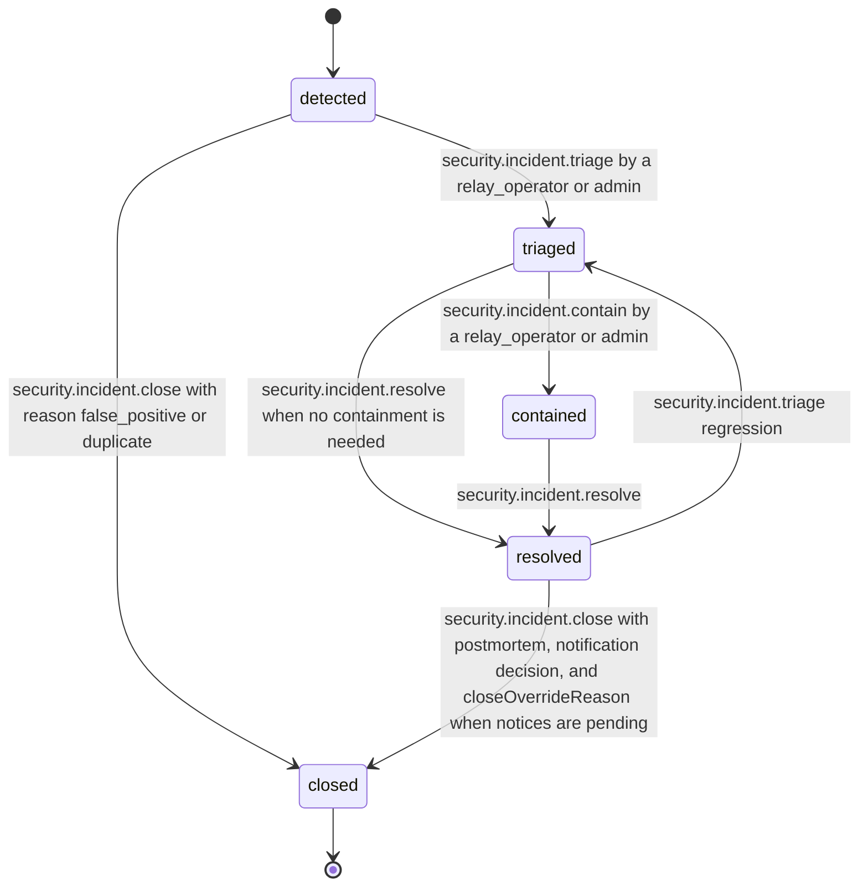

# PS-131-03 — Workflow state machine: Incident records

**Status:** SPECIFIED (Stage 3). **Module:** [F16.S03.M02 Incident records](SPEC.md) · **Scope:** MVP · **Code:** `apps/relay/src/ops/incident` · **Contracts:** [CTR-ID-001](../../../planning/contracts/CTR-ID-001.md), [CTR-EVT-001](../../../planning/contracts/CTR-EVT-001.md), [CTR-ERR-001](../../../planning/contracts/CTR-ERR-001.md), [CTR-CAP-001](../../../planning/contracts/CTR-CAP-001.md), [CTR-IDM-001](../../../planning/contracts/CTR-IDM-001.md), [CTR-PRV-001](../../../planning/contracts/CTR-PRV-001.md), [CTR-OBS-001](../../../planning/contracts/CTR-OBS-001.md), [CTR-FED-001](../../../planning/contracts/CTR-FED-001.md)

> Generated from `module.spec.yaml` by `tools/specgen`. Edit the YAML, then run `pnpm spec:render`.

## Requirements

- **PS-131-03.R01** Incidents follow the declared lifecycle and any other transition is refused with CONFLICT_STATE.
- **PS-131-03.R02** A resolved incident can return to triaged when a regression is found, and closing is final.
- **PS-131-03.R03** SLA targets are tracked per severity and breaches are recorded as timeline entries and metrics without changing status.
- **PS-131-03.R04** Detection hooks never cap SEV1 or SEV2 detections, and SEV3 and SEV4 detections beyond 20 per hour per relay are appended to one open detection_overflow SEV2 incident instead of being dropped.

## Specification

### Incident lifecycle

Initial **detected**; terminal **closed**.

| Transition | Trigger | Guard / effect |
|---|---|---|
| detected -> triaged | security.incident.triage by a relay_operator or admin | severity confirmed, commander set; emits no event |
| detected -> closed | security.incident.close with reason false_positive or duplicate | emits security.incident.closed |
| triaged -> contained | security.incident.contain by a relay_operator or admin | containedAt set, containment steps in timeline |
| triaged -> resolved | security.incident.resolve when no containment is needed | resolvedAt set |
| contained -> resolved | security.incident.resolve | resolvedAt set |
| resolved -> triaged | security.incident.triage regression | reason required |
| resolved -> closed | security.incident.close with postmortem, notification decision, and closeOverrideReason when notices are pending | emits security.incident.closed |

### Timeouts and scheduled transitions

- SLA sweep every 60 s: SEV1 acknowledgement 15 minutes and containment 60 minutes; SEV2 acknowledgement 1 hour and containment 4 hours; SEV3 acknowledgement 1 working day; SEV4 acknowledgement 5 working days.
- Notification decision due 24 hours after detection for incidents with affected data classes above P1, and notification due time detectedAt + effective.breachNotificationHours of F18.S01.M01 governance.jurisdiction_profile.resolve (24..720 hours, 72 by default).
- Postmortem due 7 days after resolution for SEV1 and SEV2.
- Hook cap window: rolling 1 hour, 20 SEV3 or SEV4 hook detections per relay; SEV1 and SEV2 are not counted against the cap.

## Verification

| Test | Level | Covers | Scenario | Expected |
|---|---|---|---|---|
| TEST-PS-131-09.T03 | property | PS-131-03.R01, PS-131-03.R02 | random command sequences on one incident | only declared transitions succeed; closed never changes; timeline length never decreases |
| TEST-PS-131-09.T04 | integration | PS-131-03.R03, PS-131-08.R03 | injected clock past SEV1 15-minute acknowledgement and 60-minute containment targets | SLA breach timeline entries and metrics; status unchanged |
| TEST-PS-131-09.T08 | integration | PS-131-09.R03, PS-131-03.R01 | close SEV1 without postmortem or notification decision; with both | SECURITY_INCIDENT_CLOSE_BLOCKED then success |
| TEST-PS-131-09.T15 | integration | PS-131-03.R04 | 25 SEV3 detections in one hour; 30 SEV2 peer key compromise detections and one SEV1 in the same hour | first 20 handled normally and the other 5 appended to one detection_overflow SEV2 incident; all SEV2 and the SEV1 handled without cap |

## Dependencies

Module depends on: F16.S01.M01, F16.S01.M02, F16.S02.M02, F16.S02.M03, F16.S03.M01, F18.S01.M01, F08.S01.M01, CTR-ID-001, CTR-EVT-001, CTR-ERR-001, CTR-CAP-001, CTR-IDM-001, CTR-PRV-001, CTR-OBS-001, CTR-FED-001. Predecessor: [domain_schema.md](domain_schema.md).
