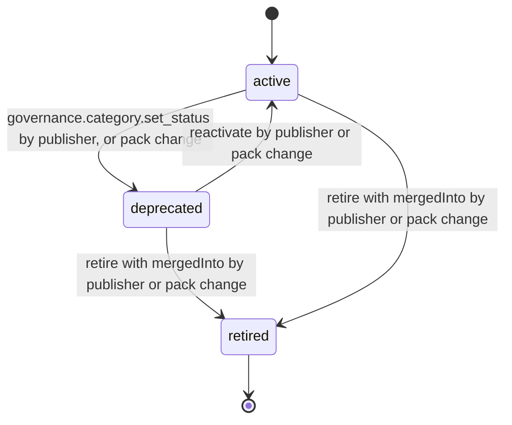

# PS-144-03 — Workflow state machine: Goods taxonomy

**Status:** SPECIFIED (Stage 3). **Module:** [F18.S01.M03 Goods taxonomy](SPEC.md) · **Scope:** MVP · **Code:** `packages/governance/src/policy/goods` · **Contracts:** [CTR-ID-001](../../../planning/contracts/CTR-ID-001.md), [CTR-EVT-001](../../../planning/contracts/CTR-EVT-001.md), [CTR-ERR-001](../../../planning/contracts/CTR-ERR-001.md), [CTR-CAP-001](../../../planning/contracts/CTR-CAP-001.md), [CTR-IDM-001](../../../planning/contracts/CTR-IDM-001.md), [CTR-PRV-001](../../../planning/contracts/CTR-PRV-001.md), [CTR-FED-001](../../../planning/contracts/CTR-FED-001.md), [CTR-SCH-001](../../../planning/contracts/CTR-SCH-001.md), [CTR-IOX-001](../../../planning/contracts/CTR-IOX-001.md)

> Generated from `module.spec.yaml` by `tools/specgen`. Edit the YAML, then run `pnpm spec:render`.

## Requirements

- **PS-144-03.R01** Category follows the declared machine in the publisher vault; user vaults mirror the status from verified packs only.
- **PS-144-03.R02** Retired is terminal and requires a merge target so listings referencing the category can be resolved.
- **PS-144-03.R03** Applying a pack is atomic: either all category changes of the pack are stored or none.

## Specification

### Category lifecycle

Initial **active**; terminal **retired**.

| Transition | Trigger | Guard / effect |
|---|---|---|
| active -> deprecated | governance.category.set_status by publisher, or pack change | hidden from new listings; existing references keep working; emits governance.category.changed |
| deprecated -> active | reactivate by publisher or pack change | emits governance.category.changed |
| deprecated -> retired | retire with mergedInto by publisher or pack change | resolve alias returns mergedInto; emits governance.category.changed |
| active -> retired | retire with mergedInto by publisher or pack change | emits governance.category.changed |

### Timeouts and scheduled transitions

- A pending untrusted pack is discarded after 30 days without a trust decision.
- A deprecated category may be retired no earlier than 30 days after deprecation.

## Verification

| Test | Level | Covers | Scenario | Expected |
|---|---|---|---|---|
| TEST-PS-144-09.T04 | property | PS-144-03.R01, PS-144-03.R02 | random status changes | only declared transitions; retired requires mergedInto; terminal never reverts |
| TEST-PS-144-09.T05 | integration | PS-144-03.R03, PS-144-06.R02 | pack with one invalid category | whole pack rejected, previous version still active |

## Dependencies

Module depends on: F18.S02.M01, F16.S02.M03, CTR-ID-001, CTR-EVT-001, CTR-ERR-001, CTR-CAP-001, CTR-IDM-001, CTR-PRV-001, CTR-FED-001, CTR-SCH-001, CTR-IOX-001. Predecessor: [domain_schema.md](domain_schema.md).
