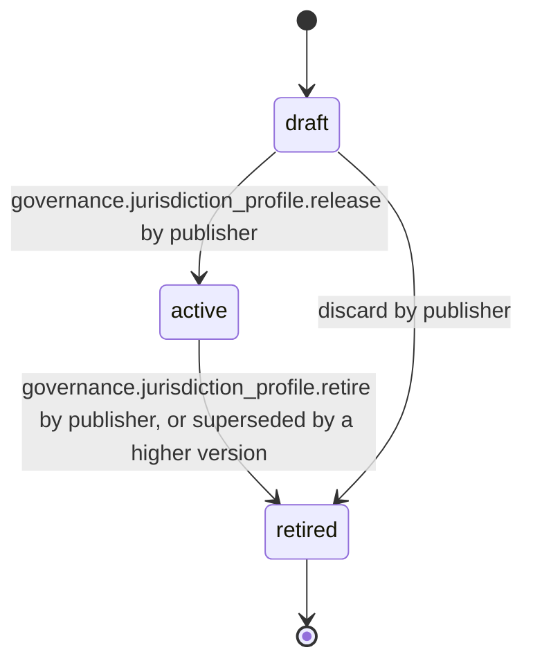

# PS-145-03 — Workflow state machine: Jurisdiction profiles

**Status:** SPECIFIED (Stage 3). **Module:** [F18.S01.M01 Jurisdiction profiles](SPEC.md) · **Scope:** MVP · **Code:** `packages/governance/src/policy/jurisdictions` · **Contracts:** [CTR-ID-001](../../../planning/contracts/CTR-ID-001.md), [CTR-EVT-001](../../../planning/contracts/CTR-EVT-001.md), [CTR-ERR-001](../../../planning/contracts/CTR-ERR-001.md), [CTR-CAP-001](../../../planning/contracts/CTR-CAP-001.md), [CTR-IDM-001](../../../planning/contracts/CTR-IDM-001.md), [CTR-PRV-001](../../../planning/contracts/CTR-PRV-001.md), [CTR-FED-001](../../../planning/contracts/CTR-FED-001.md), [CTR-SCH-001](../../../planning/contracts/CTR-SCH-001.md), [CTR-IOX-001](../../../planning/contracts/CTR-IOX-001.md)

> Generated from `module.spec.yaml` by `tools/specgen`. Edit the YAML, then run `pnpm spec:render`.

## Requirements

- **PS-145-03.R01** JurisdictionProfile follows the declared machine in the publisher vault; vaults mirror status from verified statements.
- **PS-145-03.R02** Retired is terminal; a changed profile is a new version that supersedes the previous active one atomically.
- **PS-145-03.R03** A user's local selection is separate from profile status and can be changed at any time.

## Specification

### JurisdictionProfile lifecycle

Initial **draft**; terminal **retired**.

| Transition | Trigger | Guard / effect |
|---|---|---|
| draft -> active | governance.jurisdiction_profile.release by publisher | proposal verified (except first profile); statement signed; previous active version of the same code becomes retired |
| active -> retired | governance.jurisdiction_profile.retire by publisher, or superseded by a higher version | signed retirement statement queued |
| draft -> retired | discard by publisher | local only |

### Timeouts and scheduled transitions

- A profile pending trust is discarded after 30 days without a decision.

## Verification

| Test | Level | Covers | Scenario | Expected |
|---|---|---|---|---|
| TEST-PS-145-09.T04 | property | PS-145-03.R01, PS-145-03.R02 | random lifecycle commands | only declared transitions; at most one active version per code; retired terminal |
| TEST-PS-145-09.T05 | integration | PS-145-03.R03, PS-145-04.R03 | select two overlapping profiles | stricter value wins per field; sources reported |

## Dependencies

Module depends on: F18.S01.M03, F18.S02.M01, F16.S02.M03, CTR-ID-001, CTR-EVT-001, CTR-ERR-001, CTR-CAP-001, CTR-IDM-001, CTR-PRV-001, CTR-FED-001, CTR-SCH-001, CTR-IOX-001. Predecessor: [domain_schema.md](domain_schema.md).
