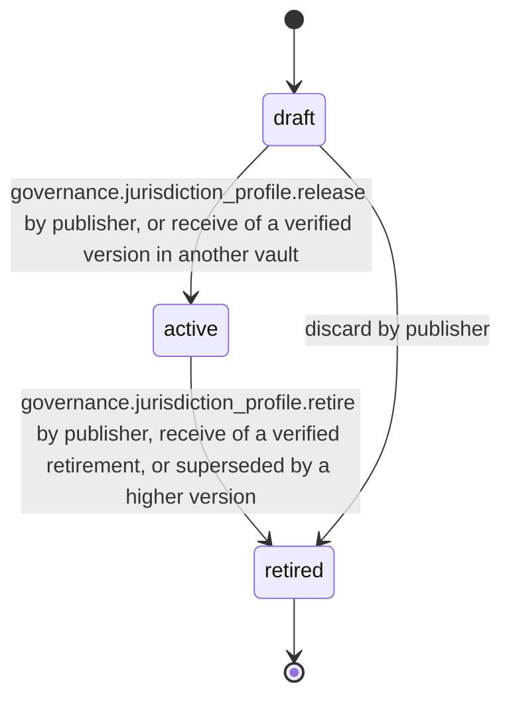
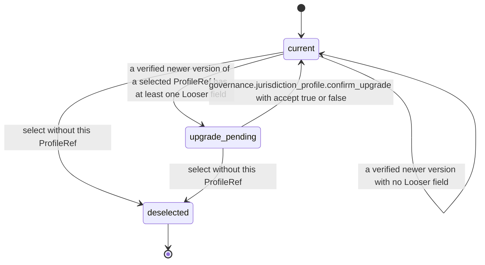

# PS-145-03 — Workflow state machine: Jurisdiction profiles

**Status:** SPECIFIED (Stage 3). **Module:** [F18.S01.M01 Jurisdiction profiles](SPEC.md) · **Scope:** MVP · **Code:** `packages/governance/src/policy/jurisdictions` · **Contracts:** [CTR-ID-001](../../../planning/contracts/CTR-ID-001.md), [CTR-EVT-001](../../../planning/contracts/CTR-EVT-001.md), [CTR-ERR-001](../../../planning/contracts/CTR-ERR-001.md), [CTR-CAP-001](../../../planning/contracts/CTR-CAP-001.md), [CTR-IDM-001](../../../planning/contracts/CTR-IDM-001.md), [CTR-PRV-001](../../../planning/contracts/CTR-PRV-001.md), [CTR-FED-001](../../../planning/contracts/CTR-FED-001.md), [CTR-SCH-001](../../../planning/contracts/CTR-SCH-001.md), [CTR-IOX-001](../../../planning/contracts/CTR-IOX-001.md), [CTR-MNY-001](../../../planning/contracts/CTR-MNY-001.md)

> Generated from `module.spec.yaml` by `tools/specgen`. Edit the YAML, then run `pnpm spec:render`.

## Requirements

- **PS-145-03.R01** JurisdictionProfile follows the declared machine in the publisher vault; vaults mirror status from verified statements.
- **PS-145-03.R02** Retired is terminal; a changed profile is a new version that supersedes the previous active one atomically.
- **PS-145-03.R03** A user's local selection is separate from profile status and can be changed at any time.
- **PS-145-03.R04** A selection follows its ProfileRef to newer versions: a new version applies automatically only if no governed field becomes Looser by the merge table; otherwise the selection stays upgrade_pending on the current version until the owner confirms, and Looser retention values then apply only to records created after effectiveFrom.

## Specification

### JurisdictionProfile lifecycle

Initial **draft**; terminal **retired**.

| Transition | Trigger | Guard / effect |
|---|---|---|
| draft -> active | governance.jurisdiction_profile.release by publisher, or receive of a verified version in another vault | decision verified when governed fields differ from the previous version or, for a new code, from the generic profile; statement signed; previous active version of the same ProfileRef becomes retired; emits activated (released) |
| active -> retired | governance.jurisdiction_profile.retire by publisher, receive of a verified retirement, or superseded by a higher version | signed retirement statement queued in the publisher vault; emits activated (retired) |
| draft -> retired | discard by publisher | local only |

### ProfileSelection lifecycle

Initial **current**; terminal **deselected**.

| Transition | Trigger | Guard / effect |
|---|---|---|
| current -> upgrade_pending | a verified newer version of a selected ProfileRef has at least one Looser field | previous version stays in use; owner notified; emits activated (upgrade_pending) |
| upgrade_pending -> current | governance.jurisdiction_profile.confirm_upgrade with accept true or false | accept: new version in use with Looser retention only for records created after effectiveFrom, emits activated (upgraded); decline: previous version kept |
| current -> current | a verified newer version with no Looser field | new version in use automatically; emits activated (upgraded) |
| current -> deselected | select without this ProfileRef | emits activated (deselected) |
| upgrade_pending -> deselected | select without this ProfileRef | emits activated (deselected) |

### Timeouts and scheduled transitions

- Profiles from untrusted or paused publishers follow the F18.S02.M01 PendingStatement lifecycle and are discarded after 30 days without a decision.
- An upgrade_pending selection reminds the owner after 7 days and keeps the previous version until the owner answers.

## Verification

| Test | Level | Covers | Scenario | Expected |
|---|---|---|---|---|
| TEST-PS-145-09.T04 | property | PS-145-03.R01, PS-145-03.R02 | random lifecycle commands | only declared transitions; at most one active version per ProfileRef; retired terminal |
| TEST-PS-145-09.T05 | integration | PS-145-03.R03, PS-145-04.R03, PS-145-02.R05 | table-driven: for every merge-table row select two overlapping profiles with differing values | each field merged in its table direction (max, min or union); sources reported per field; Compare labels match the table |
| TEST-PS-145-09.T19 | integration | PS-145-03.R04, PS-145-07.R04 | version 4 of a selected eu_de shortens evidenceDays; owner confirms; version 5 only adds a notice; R1 evaluated after each bump | upgrade_pending until confirmed and shorter retention applies only to records created after effectiveFrom; version 5 applies automatically; R1 keeps matching through ProfileRef |

## Dependencies

Module depends on: F18.S01.M03, F18.S02.M01, F16.S02.M03, F11.S01.M01, F15.S02.M01, F10.S02.M02, CTR-ID-001, CTR-EVT-001, CTR-ERR-001, CTR-CAP-001, CTR-IDM-001, CTR-PRV-001, CTR-FED-001, CTR-SCH-001, CTR-IOX-001, CTR-MNY-001. Predecessor: [domain_schema.md](domain_schema.md).
