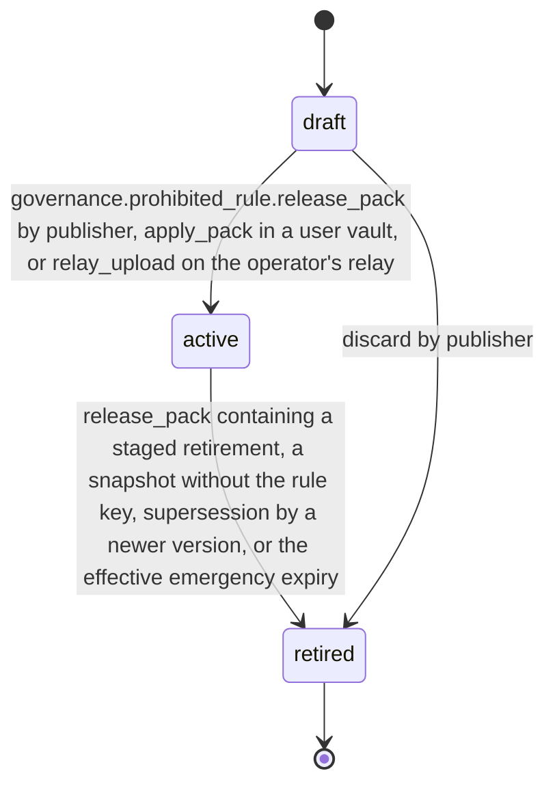

# PS-146-03 — Workflow state machine: Prohibited items

**Status:** SPECIFIED (Stage 3). **Module:** [F18.S01.M02 Prohibited items](SPEC.md) · **Scope:** MVP · **Code:** `packages/governance/src/policy/prohibited` · **Contracts:** [CTR-ID-001](../../../planning/contracts/CTR-ID-001.md), [CTR-EVT-001](../../../planning/contracts/CTR-EVT-001.md), [CTR-ERR-001](../../../planning/contracts/CTR-ERR-001.md), [CTR-CAP-001](../../../planning/contracts/CTR-CAP-001.md), [CTR-IDM-001](../../../planning/contracts/CTR-IDM-001.md), [CTR-PRV-001](../../../planning/contracts/CTR-PRV-001.md), [CTR-FED-001](../../../planning/contracts/CTR-FED-001.md), [CTR-SCH-001](../../../planning/contracts/CTR-SCH-001.md), [CTR-IOX-001](../../../planning/contracts/CTR-IOX-001.md)

> Generated from `module.spec.yaml` by `tools/specgen`. Edit the YAML, then run `pnpm spec:render`.

## Requirements

- **PS-146-03.R01** ProhibitedRule follows the declared machine; retired is terminal and a rule is changed only by activating a new version.
- **PS-146-03.R02** Activating a version retires the previous active version of the same key in the same transaction and increases the ruleset version.
- **PS-146-03.R03** Emergency rules retire automatically at their effective expiry, min(emergencyUntil, firstSeenAt + 7 days); the sweep and the evaluation both honour it.
- **PS-146-03.R04** When an applied pack gives a block verdict for an already active publication, the publication is held for its owner (policy_attention in F01.S01.M03): the owner is notified, renewals and re-publication of unchanged content stop until the owner resolves it by an edit that clears the verdict or by confirming Unpublish, and nothing is unpublished or tombstoned before that confirmation.

## Specification

### ProhibitedRule lifecycle

Initial **draft**; terminal **retired**.

| Transition | Trigger | Guard / effect |
|---|---|---|
| draft -> active | governance.prohibited_rule.release_pack by publisher, apply_pack in a user vault, or relay_upload on the operator's relay | decision verified for new or changed versions, or emergency within V06 and V11; previous version retired; emits governance.prohibited_rule.changed |
| active -> retired | release_pack containing a staged retirement, a snapshot without the rule key, supersession by a newer version, or the effective emergency expiry | emits governance.prohibited_rule.changed (retired or emergency_expired) |
| draft -> retired | discard by publisher | local only |

### Timeouts and scheduled transitions

- Emergency rules retire at the effective expiry (at most 7 days after first sight); sweep every 5 minutes while the app is open and at app start.
- Packs from untrusted or paused publishers follow the F18.S02.M01 PendingStatement lifecycle and are discarded after 30 days.
- Emergency history entries are kept 30 days after their effective expiry for V11.

## Verification

| Test | Level | Covers | Scenario | Expected |
|---|---|---|---|---|
| TEST-PS-146-09.T04 | property | PS-146-03.R01, PS-146-03.R02 | random lifecycle commands | only declared transitions; one active version per key; new version retires old one atomically; retirement only through a released pack |
| TEST-PS-146-09.T05 | integration | PS-146-03.R03 | emergency rule passes its effective expiry | retired automatically, emergency_expired event emitted, evaluation ignores it |
| TEST-PS-146-09.T07 | integration | PS-146-03.R04, PS-146-07.R04 | apply a pack that blocks an active publication in the F01.S01.M03 fixture; advance 7 days; owner confirms Unpublish | publication held as policy_attention with owner notice, renewals and unchanged re-publication stopped, an edit that clears the verdict resolves it; no tombstone signed before confirmation; reminder after 7 days; tombstone only after confirmation |
| TEST-PS-146-09.T20 | abuse | PS-146-02.R05, PS-146-03.R03 | emergency rule re-issued under the same key each week; emergency rule with activation dated 30 days in the future | second activation within 30 days rejected with GOVERNANCE_RULE_EMERGENCY_INVALID; future-dated rule expires 7 days after first sight |

## Dependencies

Module depends on: F18.S01.M03, F18.S01.M01, F18.S02.M01, F16.S02.M03, F11.S01.M01, F07.S02.M01, F15.S02.M01, CTR-ID-001, CTR-EVT-001, CTR-ERR-001, CTR-CAP-001, CTR-IDM-001, CTR-PRV-001, CTR-FED-001, CTR-SCH-001, CTR-IOX-001. Predecessor: [domain_schema.md](domain_schema.md).
