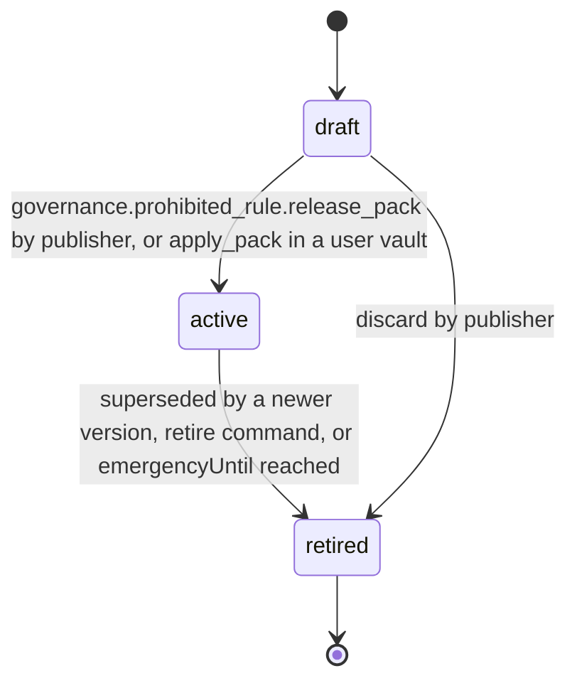

# PS-146-03 — Workflow state machine: Prohibited items

**Status:** SPECIFIED (Stage 3). **Module:** [F18.S01.M02 Prohibited items](SPEC.md) · **Scope:** MVP · **Code:** `packages/governance/src/policy/prohibited` · **Contracts:** [CTR-ID-001](../../../planning/contracts/CTR-ID-001.md), [CTR-EVT-001](../../../planning/contracts/CTR-EVT-001.md), [CTR-ERR-001](../../../planning/contracts/CTR-ERR-001.md), [CTR-CAP-001](../../../planning/contracts/CTR-CAP-001.md), [CTR-IDM-001](../../../planning/contracts/CTR-IDM-001.md), [CTR-PRV-001](../../../planning/contracts/CTR-PRV-001.md), [CTR-FED-001](../../../planning/contracts/CTR-FED-001.md), [CTR-SCH-001](../../../planning/contracts/CTR-SCH-001.md), [CTR-IOX-001](../../../planning/contracts/CTR-IOX-001.md)

> Generated from `module.spec.yaml` by `tools/specgen`. Edit the YAML, then run `pnpm spec:render`.

## Requirements

- **PS-146-03.R01** ProhibitedRule follows the declared machine; retired is terminal and a rule is changed only by activating a new version.
- **PS-146-03.R02** Activating a version retires the previous active version of the same key in the same transaction and increases the ruleset version.
- **PS-146-03.R03** Emergency rules retire automatically at emergencyUntil; the sweep and the evaluation both honour the expiry.

## Specification

### ProhibitedRule lifecycle

Initial **draft**; terminal **retired**.

| Transition | Trigger | Guard / effect |
|---|---|---|
| draft -> active | governance.prohibited_rule.release_pack by publisher, or apply_pack in a user vault | proposal verified or emergency; previous version retired; emits governance.prohibited_rule.changed |
| active -> retired | superseded by a newer version, retire command, or emergencyUntil reached | emits governance.prohibited_rule.changed |
| draft -> retired | discard by publisher | local only |

### Timeouts and scheduled transitions

- Emergency rules retire at emergencyUntil (maximum 7 days); sweep every 5 minutes while the app is open and at app start.
- A pending untrusted pack is discarded after 30 days.

## Verification

| Test | Level | Covers | Scenario | Expected |
|---|---|---|---|---|
| TEST-PS-146-09.T04 | property | PS-146-03.R01, PS-146-03.R02 | random lifecycle commands | only declared transitions; one active version per key; new version retires old one atomically |
| TEST-PS-146-09.T05 | integration | PS-146-03.R03, PS-146-08.R03 | emergency rule passes 7 days | retired automatically, emergency_expired event emitted, evaluation ignores it |

## Dependencies

Module depends on: F18.S01.M03, F18.S01.M01, F18.S02.M01, F16.S02.M03, CTR-ID-001, CTR-EVT-001, CTR-ERR-001, CTR-CAP-001, CTR-IDM-001, CTR-PRV-001, CTR-FED-001, CTR-SCH-001, CTR-IOX-001. Predecessor: [domain_schema.md](domain_schema.md).
