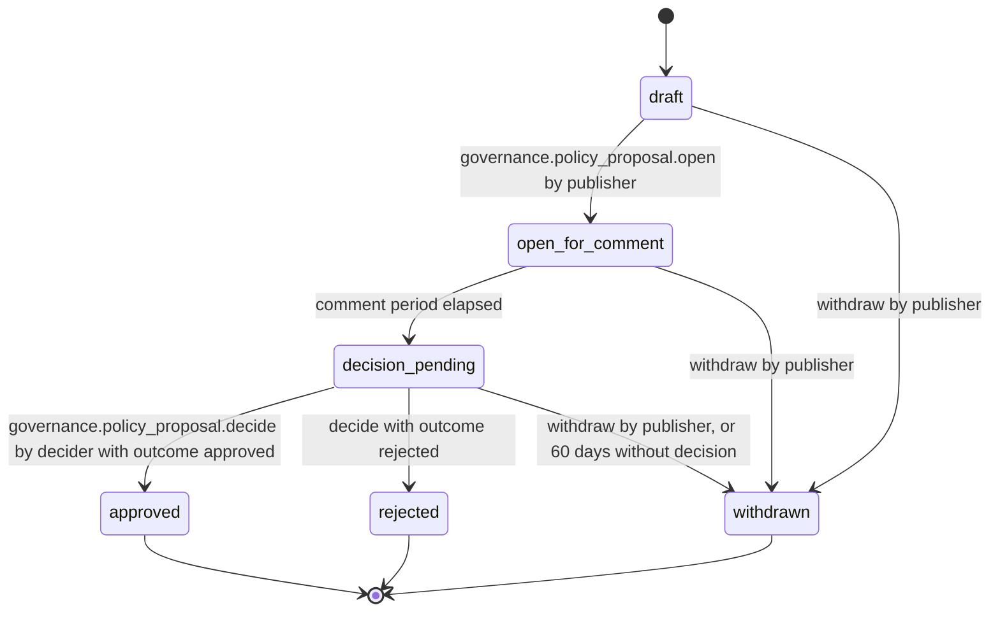

# PS-147-03 — Workflow state machine: Community governance

**Status:** SPECIFIED (Stage 3). **Module:** [F18.S02.M01 Community governance](SPEC.md) · **Scope:** MVP · **Code:** `packages/governance/src/community/governance` · **Contracts:** [CTR-ID-001](../../../planning/contracts/CTR-ID-001.md), [CTR-EVT-001](../../../planning/contracts/CTR-EVT-001.md), [CTR-ERR-001](../../../planning/contracts/CTR-ERR-001.md), [CTR-CAP-001](../../../planning/contracts/CTR-CAP-001.md), [CTR-IDM-001](../../../planning/contracts/CTR-IDM-001.md), [CTR-PRV-001](../../../planning/contracts/CTR-PRV-001.md), [CTR-FED-001](../../../planning/contracts/CTR-FED-001.md), [CTR-SCH-001](../../../planning/contracts/CTR-SCH-001.md), [CTR-IOX-001](../../../planning/contracts/CTR-IOX-001.md)

> Generated from `module.spec.yaml` by `tools/specgen`. Edit the YAML, then run `pnpm spec:render`.

## Requirements

- **PS-147-03.R01** PolicyProposal follows the declared machine; approved, rejected and withdrawn are terminal.
- **PS-147-03.R02** The comment period ends by the publisher's clock and by the relay clock for accepting comments; both are claims and are shown as such.
- **PS-147-03.R03** A decision cannot be reversed; a new proposal is required to change policy again.

## Specification

### PolicyProposal lifecycle

Initial **draft**; terminal **approved**, **rejected**, **withdrawn**.

| Transition | Trigger | Guard / effect |
|---|---|---|
| draft -> open_for_comment | governance.policy_proposal.open by publisher | statement classrup.governance.policy_proposal/v1 signed and queued; emits governance.policy_proposal.opened |
| draft -> withdrawn | withdraw by publisher | local only, nothing was published |
| open_for_comment -> decision_pending | comment period elapsed | publisher vault clock or sweep at app start |
| open_for_comment -> withdrawn | withdraw by publisher | signed withdrawal statement queued |
| decision_pending -> approved | governance.policy_proposal.decide by decider with outcome approved | decision statement signed; emits governance.policy_proposal.decided |
| decision_pending -> rejected | decide with outcome rejected | decision statement signed; emits governance.policy_proposal.decided |
| decision_pending -> withdrawn | withdraw by publisher, or 60 days without decision | signed withdrawal statement queued |

### Timeouts and scheduled transitions

- open_for_comment moves to decision_pending at commentEndsAt (sweep every 60 s while the publisher vault is open, and at start).
- decision_pending becomes withdrawn after 60 days without a decision.
- An approved decision is usable for verification for 30 days after decidedAt.

## Verification

| Test | Level | Covers | Scenario | Expected |
|---|---|---|---|---|
| TEST-PS-147-09.T03 | property | PS-147-03.R01, PS-147-03.R03 | random command and clock sequences | only declared transitions; terminal states never leave; decision cannot be reversed |
| TEST-PS-147-09.T04 | integration | PS-147-03.R02, PS-147-02.R03 | comment accepted by relay clock after publisher clock ended | relay clock decides acceptance; UI labels times as claims |

## Dependencies

Module depends on: F16.S02.M03, F11.S01.M01, CTR-ID-001, CTR-EVT-001, CTR-ERR-001, CTR-CAP-001, CTR-IDM-001, CTR-PRV-001, CTR-FED-001, CTR-SCH-001, CTR-IOX-001. Predecessor: [domain_schema.md](domain_schema.md).
