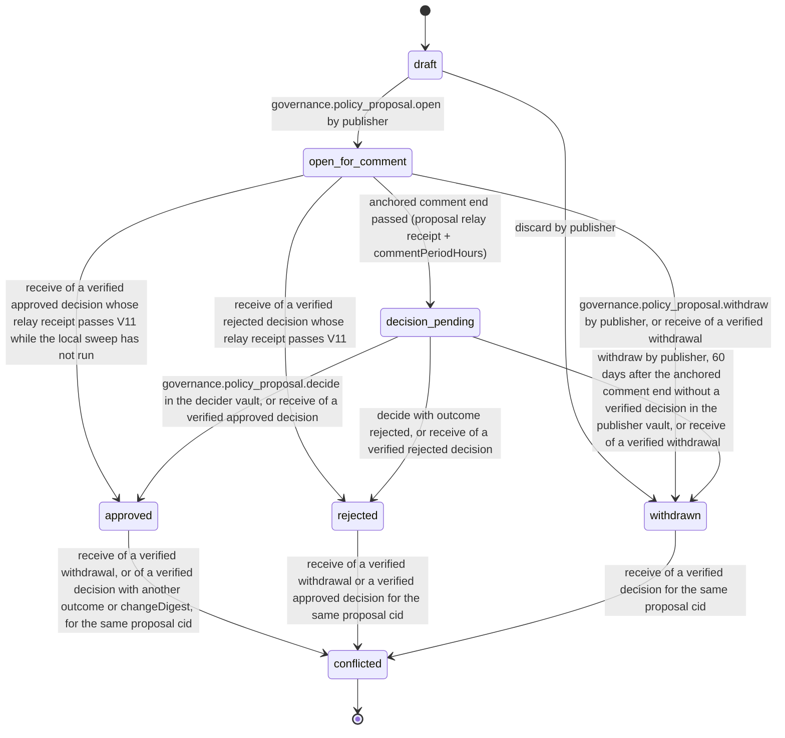
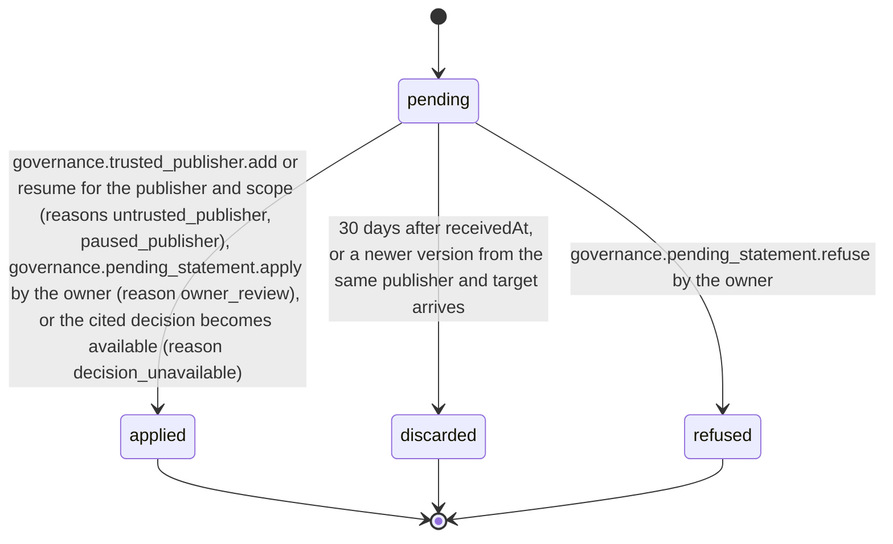

# PS-147-03 — Workflow state machine: Community governance

**Status:** SPECIFIED (Stage 3). **Module:** [F18.S02.M01 Community governance](SPEC.md) · **Scope:** MVP · **Code:** `packages/governance/src/community/governance` · **Contracts:** [CTR-ID-001](../../../planning/contracts/CTR-ID-001.md), [CTR-EVT-001](../../../planning/contracts/CTR-EVT-001.md), [CTR-ERR-001](../../../planning/contracts/CTR-ERR-001.md), [CTR-CAP-001](../../../planning/contracts/CTR-CAP-001.md), [CTR-IDM-001](../../../planning/contracts/CTR-IDM-001.md), [CTR-PRV-001](../../../planning/contracts/CTR-PRV-001.md), [CTR-FED-001](../../../planning/contracts/CTR-FED-001.md), [CTR-SCH-001](../../../planning/contracts/CTR-SCH-001.md), [CTR-IOX-001](../../../planning/contracts/CTR-IOX-001.md)

> Generated from `module.spec.yaml` by `tools/specgen`. Edit the YAML, then run `pnpm spec:render`.

## Requirements

- **PS-147-03.R01** PolicyProposal follows the declared machine; conflicted is terminal, and approved, rejected and withdrawn are final for their signers and change only to conflicted when a validly signed contradicting statement is verified.
- **PS-147-03.R02** The comment period starts at the relay-signed receipt of the proposal statement and ends commentPeriodHours later on that relay's clock; publisher and decider timestamps are claims and are shown as such.
- **PS-147-03.R03** A decision cannot be reversed; a new proposal is required to change policy again.
- **PS-147-03.R04** Vaults other than the authoring vault move their mirror only on verified received statements, and a verified withdrawal plus a verified decision, or two verified decisions with different outcomes, for the same proposal cid make it conflicted in every vault that sees both.
- **PS-147-03.R05** PendingStatement follows its own machine: pending items are applied when the publisher becomes trusted for the scope or the owner applies them, and are discarded after 30 days or refused by the owner.

## Specification

### PolicyProposal lifecycle

Initial **draft**; terminal **conflicted**.

| Transition | Trigger | Guard / effect |
|---|---|---|
| draft -> open_for_comment | governance.policy_proposal.open by publisher | statement classrup.governance.policy_proposal/v1 signed and queued (prepared); expedited requires a verified policy_cosign; emits governance.policy_proposal.opened |
| draft -> withdrawn | discard by publisher | local only, nothing was published |
| open_for_comment -> decision_pending | anchored comment end passed (proposal relay receipt + commentPeriodHours) | sweep every 60 s in any open vault holding the mirror and at start; no statement |
| open_for_comment -> withdrawn | governance.policy_proposal.withdraw by publisher, or receive of a verified withdrawal | publisher vault queues the signed withdrawal; other vaults record withdrawalCid |
| open_for_comment -> approved | receive of a verified approved decision whose relay receipt passes V11 while the local sweep has not run | emits governance.policy_proposal.decided |
| open_for_comment -> rejected | receive of a verified rejected decision whose relay receipt passes V11 | emits governance.policy_proposal.decided |
| decision_pending -> approved | governance.policy_proposal.decide in the decider vault, or receive of a verified approved decision | decision statement signed or recorded; emits governance.policy_proposal.decided |
| decision_pending -> rejected | decide with outcome rejected, or receive of a verified rejected decision | emits governance.policy_proposal.decided |
| decision_pending -> withdrawn | withdraw by publisher, 60 days after the anchored comment end without a verified decision in the publisher vault, or receive of a verified withdrawal | publisher vault queues the signed withdrawal |
| approved -> conflicted | receive of a verified withdrawal, or of a verified decision with another outcome or changeDigest, for the same proposal cid | conflictCids recorded; verify returns conflicted; emits governance.policy_proposal.decided with outcome conflicted |
| rejected -> conflicted | receive of a verified withdrawal or a verified approved decision for the same proposal cid | conflictCids recorded; emits governance.policy_proposal.decided with outcome conflicted |
| withdrawn -> conflicted | receive of a verified decision for the same proposal cid | conflictCids recorded; emits governance.policy_proposal.decided with outcome conflicted |

### PendingStatement lifecycle

Initial **pending**; terminal **applied**, **discarded**, **refused**.

| Transition | Trigger | Guard / effect |
|---|---|---|
| pending -> applied | governance.trusted_publisher.add or resume for the publisher and scope (reasons untrusted_publisher, paused_publisher), governance.pending_statement.apply by the owner (reason owner_review), or the cited decision becomes available (reason decision_unavailable) | the owning module's apply succeeds through PendingApplyPort; otherwise the entry stays pending with the new reason |
| pending -> refused | governance.pending_statement.refuse by the owner | envelope kept 30 days as refused history; nothing applied |
| pending -> discarded | 30 days after receivedAt, or a newer version from the same publisher and target arrives | envelope deleted |

### Timeouts and scheduled transitions

- open_for_comment moves to decision_pending at the anchored commentEndsAt (sweep every 60 s while a vault is open, and at start).
- decision_pending becomes withdrawn in the publisher vault 60 days after the anchored comment end without a verified decision; a decision signed in parallel elsewhere then makes the proposal conflicted.
- An approved decision may activate a target only while asOf (the activation's anchored time) is at most validUntil = decision anchor + 30 days; it never expires for content already activated within the window.
- A PendingStatement is discarded 30 days after receivedAt (sweep at start and every 6 h).

## Verification

| Test | Level | Covers | Scenario | Expected |
|---|---|---|---|---|
| TEST-PS-147-09.T03 | property | PS-147-03.R01, PS-147-03.R03 | random command, receive and clock sequences in authoring and mirror vaults | only declared transitions; conflicted never leaves; a decision is never reversed |
| TEST-PS-147-09.T04 | integration | PS-147-03.R02, PS-147-02.R03, PS-147-02.R04 | comment accepted by relay clock after the publisher clock ended; publisher clock skewed by 2 days | relay receipt decides acceptance and commentEndsAt = proposal receipt + period; UI labels other times as claims |
| TEST-PS-147-09.T10 | integration | PS-147-06.R03, PS-147-03.R04 | two conflicting decisions delivered to a receiver | proposal marked conflicted; verify returns false with reason conflicted; decided event with outcome conflicted |
| TEST-PS-147-09.T17 | integration | PS-147-03.R04, PS-147-06.R02, PS-147-06.R03 | publisher P withdraws while decider D, offline, approves; deliver both to third vault V in both orders | V marks conflicted with both cids in either order; verify returns conflicted; a new proposal is required |
| TEST-PS-147-09.T18 | abuse | PS-147-02.R04, PS-147-04.R03, PS-147-03.R02 | proposal with openedAt backdated by 3 days; decision received 1 h after the proposal receipt; decision without a receipt | openedAt rejected (below receipt - 10 min); verify returns period_not_elapsed for both decisions |
| TEST-PS-147-09.T21 | integration | PS-147-01.R04, PS-147-03.R05, PS-147-04.R05 | untrusted pack held; trust added from the dialog; sync ingestion calls trusted_publisher.add; another pending item expires; owner refuses one; owner pauses a trusted publisher, a new statement arrives, owner resumes | held item applied through PendingApplyPort; ingestion call FORBIDDEN; expired item discarded after 30 days; refused item refused; paused statement held with paused_publisher and applied on resume while applied configuration stayed in force |

## Dependencies

Module depends on: F16.S02.M03, F11.S01.M01, F15.S02.M01, F12.S03.M03, F10.S02.M02, CTR-ID-001, CTR-EVT-001, CTR-ERR-001, CTR-CAP-001, CTR-IDM-001, CTR-PRV-001, CTR-FED-001, CTR-SCH-001, CTR-IOX-001. Predecessor: [domain_schema.md](domain_schema.md).
