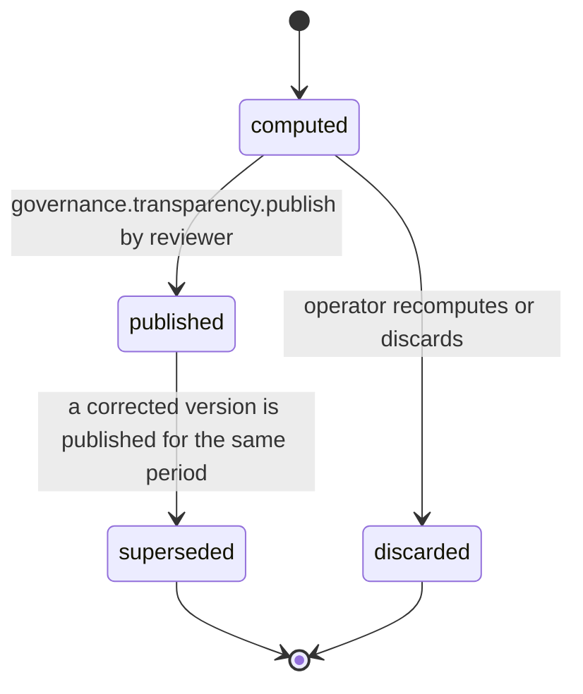

# PS-148-03 — Workflow state machine: Transparency reports

**Status:** SPECIFIED (Stage 3). **Module:** [F18.S02.M02 Transparency reports](SPEC.md) · **Scope:** MVP · **Code:** `packages/governance/src/community/transparency` · **Contracts:** [CTR-ID-001](../../../planning/contracts/CTR-ID-001.md), [CTR-EVT-001](../../../planning/contracts/CTR-EVT-001.md), [CTR-ERR-001](../../../planning/contracts/CTR-ERR-001.md), [CTR-CAP-001](../../../planning/contracts/CTR-CAP-001.md), [CTR-IDM-001](../../../planning/contracts/CTR-IDM-001.md), [CTR-PRV-001](../../../planning/contracts/CTR-PRV-001.md), [CTR-FED-001](../../../planning/contracts/CTR-FED-001.md), [CTR-SCH-001](../../../planning/contracts/CTR-SCH-001.md), [CTR-IOX-001](../../../planning/contracts/CTR-IOX-001.md), [CTR-OBS-001](../../../planning/contracts/CTR-OBS-001.md)

> Generated from `module.spec.yaml` by `tools/specgen`. Edit the YAML, then run `pnpm spec:render`.

## Requirements

- **PS-148-03.R01** TransparencyReport follows the declared machine; superseded and discarded are terminal.
- **PS-148-03.R02** Publication needs a reviewer key different from the compiler key; there is no single-person publication path.
- **PS-148-03.R03** A published report is never edited; corrections create a new version that supersedes it.

## Specification

### TransparencyReport lifecycle

Initial **computed**; terminal **superseded**, **discarded**.

| Transition | Trigger | Guard / effect |
|---|---|---|
| computed -> published | governance.transparency.publish by reviewer | suppression verified; statement signed; previous published version of the period becomes superseded; emits governance.transparency.published |
| computed -> discarded | operator recomputes or discards | counters unchanged |
| published -> superseded | a corrected version is published for the same period | earlier version stays downloadable with a superseded marker |

### Timeouts and scheduled transitions

- Overdue alert if a period has no published report 30 days after periodEnd; repeated weekly.
- Computed reports not reviewed within 14 days are discarded and must be recomputed.
- Counters are deleted 90 days after the period's report is published (RET-SHORT window kept for corrections).

## Verification

| Test | Level | Covers | Scenario | Expected |
|---|---|---|---|---|
| TEST-PS-148-09.T04 | property | PS-148-03.R01, PS-148-03.R03 | random lifecycle commands | only declared transitions; one published version per period; corrections supersede |
| TEST-PS-148-09.T05 | integration | PS-148-03.R02, PS-148-05.R02 | same key publishes; reviewer different key publishes | GOVERNANCE_TRANSPARENCY_SELF_REVIEW for the same key; success for O2 |

## Dependencies

Module depends on: F18.S02.M01, F16.S02.M03, CTR-ID-001, CTR-EVT-001, CTR-ERR-001, CTR-CAP-001, CTR-IDM-001, CTR-PRV-001, CTR-FED-001, CTR-SCH-001, CTR-IOX-001, CTR-OBS-001. Predecessor: [domain_schema.md](domain_schema.md).
