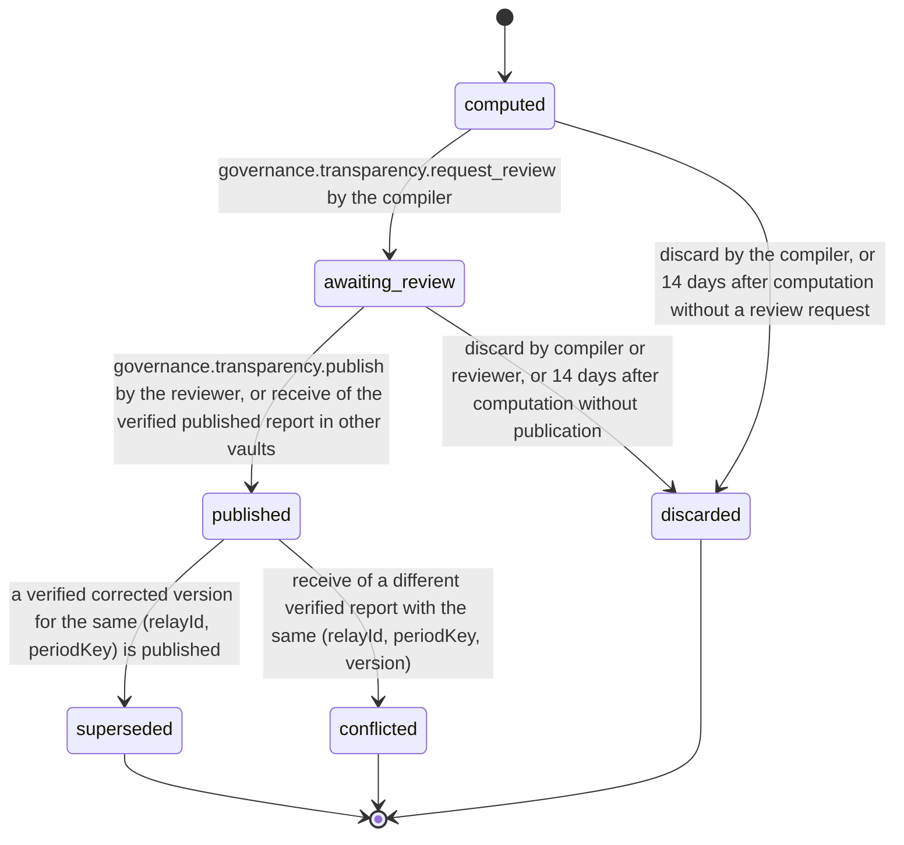

# PS-148-03 — Workflow state machine: Transparency reports

**Status:** SPECIFIED (Stage 3). **Module:** [F18.S02.M02 Transparency reports](SPEC.md) · **Scope:** MVP · **Code:** `packages/governance/src/community/transparency` · **Contracts:** [CTR-ID-001](../../../planning/contracts/CTR-ID-001.md), [CTR-EVT-001](../../../planning/contracts/CTR-EVT-001.md), [CTR-ERR-001](../../../planning/contracts/CTR-ERR-001.md), [CTR-CAP-001](../../../planning/contracts/CTR-CAP-001.md), [CTR-IDM-001](../../../planning/contracts/CTR-IDM-001.md), [CTR-PRV-001](../../../planning/contracts/CTR-PRV-001.md), [CTR-FED-001](../../../planning/contracts/CTR-FED-001.md), [CTR-SCH-001](../../../planning/contracts/CTR-SCH-001.md), [CTR-IOX-001](../../../planning/contracts/CTR-IOX-001.md), [CTR-OBS-001](../../../planning/contracts/CTR-OBS-001.md)

> Generated from `module.spec.yaml` by `tools/specgen`. Edit the YAML, then run `pnpm spec:render`.

## Requirements

- **PS-148-03.R01** TransparencyReport follows the declared machine; superseded, discarded and conflicted are terminal.
- **PS-148-03.R02** Publication needs a compiler-signed draft and a reviewer countersignature by a different operator key of the same relay; there is no single-key publication path.
- **PS-148-03.R03** A published report is never edited; corrections create a new version that supersedes it.
- **PS-148-03.R04** Counters of a period freeze 24 hours after periodEnd on the relay's clock, so every snapshot of a frozen period is byte-identical and both operators can obtain the same snapshotCid.

## Specification

### TransparencyReport lifecycle

Initial **computed**; terminal **superseded**, **discarded**, **conflicted**.

| Transition | Trigger | Guard / effect |
|---|---|---|
| computed -> awaiting_review | governance.transparency.request_review by the compiler | draft classrup.governance.transparency_draft/v1 signed and sealed to the reviewer; in the reviewer vault the received draft is stored directly as awaiting_review |
| computed -> discarded | discard by the compiler, or 14 days after computation without a review request | counters unchanged |
| awaiting_review -> published | governance.transparency.publish by the reviewer, or receive of the verified published report in other vaults | both signatures verified; previous published version of the period becomes superseded; emits governance.transparency.published |
| awaiting_review -> discarded | discard by compiler or reviewer, or 14 days after computation without publication | the draft is not published |
| published -> superseded | a verified corrected version for the same (relayId, periodKey) is published | earlier version stays downloadable with a superseded marker |
| published -> conflicted | receive of a different verified report with the same (relayId, periodKey, version) | both marked conflicted; neither shown as current |

### Timeouts and scheduled transitions

- Overdue alert if a period has no published report 30 days after periodEnd; repeated weekly.
- Computed or awaiting_review reports are discarded 14 days after computation if not published and must be recomputed.
- Counters freeze at periodEnd + 24 h (relay time).
- Counters are purged exactly 90 days after the period's report is published, through RetentionPurgePort, and never later than the RET-AUDIT bound of 1 year.

## Verification

| Test | Level | Covers | Scenario | Expected |
|---|---|---|---|---|
| TEST-PS-148-09.T04 | property | PS-148-03.R01, PS-148-03.R03 | random lifecycle commands | only declared transitions; one published version per period; corrections supersede; terminal states never leave |
| TEST-PS-148-09.T05 | integration | PS-148-03.R02, PS-148-02.R04 | O1 publishes its own draft; O2 publishes; X countersigns; V receives each | GOVERNANCE_TRANSPARENCY_SELF_REVIEW for O1 and for X's report in V; O2's report verified with both signatures against the operator list |
| TEST-PS-148-09.T19 | integration | PS-148-04.R02, PS-148-01.R04, PS-148-03.R04 | F12 fixtures emit relay-local events through the quarter; relay freezes at periodEnd + 24 h; O1 and O2 each fetch the snapshot; O1 computes and requests review; O2 recomputes and publishes | both snapshots have the same snapshotCid; O2's recomputed contentCid equals O1's; the published report matches the event fixture after suppression |
| TEST-PS-148-09.T21 | integration | PS-148-03.R02, PS-148-04.R03 | two different verified version-1 reports for 2026-Q3 reach V in either order | both marked conflicted; get_published returns conflicted true and neither is current |

## Dependencies

Module depends on: F18.S02.M01, F16.S02.M03, F11.S01.M01, F15.S02.M01, F15.S04.M03, F07.S02.M01, F12.S01.M01, F12.S01.M03, F12.S02.M01, F12.S02.M02, F10.S01.M02, F10.S02.M02, CTR-ID-001, CTR-EVT-001, CTR-ERR-001, CTR-CAP-001, CTR-IDM-001, CTR-PRV-001, CTR-FED-001, CTR-SCH-001, CTR-IOX-001, CTR-OBS-001. Predecessor: [domain_schema.md](domain_schema.md).
