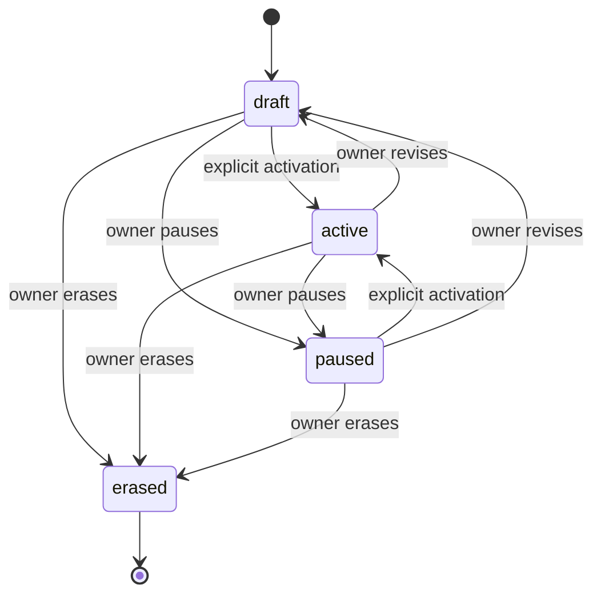

# PS-149-03 — Workflow state machine: Private local intents

**Status:** SPECIFIED (Stage 3). **Module:** [F19.S01.M01 Private local intents](SPEC.md) · **Scope:** FUTURE · **Code:** `packages/blindmatch/src/intents/local` · **Contracts:** [CTR-ERR-001](../../../planning/contracts/CTR-ERR-001.md), [CTR-PRV-001](../../../planning/contracts/CTR-PRV-001.md), [CTR-IOX-001](../../../planning/contracts/CTR-IOX-001.md), [CTR-TST-001](../../../planning/contracts/CTR-TST-001.md)

> Generated from `module.spec.yaml` by `tools/specgen`. Edit the YAML, then run `pnpm spec:render`.

## Requirements

- **PS-149-03.R01** Create as draft; activation requires explicit owner action against the current revision and unexpired content.
- **PS-149-03.R02** Edits reset state to draft; pause stops matching and erase removes the row instead of storing erased state.
- **PS-149-03.R03** Invalidate the ephemeral epoch before mutations and permanently revoke the store instance after session loss.

## Specification

### PrivateIntent lifecycle

Initial **draft**; terminal **erased**.

| Transition | Trigger | Guard / effect |
|---|---|---|
| draft -> active | explicit activation | current revision and unexpired content |
| draft -> paused | owner pauses | current revision |
| active -> paused | owner pauses | current revision |
| paused -> active | explicit activation | current revision and unexpired content |
| active -> draft | owner revises | new revision invalidates matching |
| paused -> draft | owner revises | new revision invalidates matching |
| draft -> erased | owner erases | remove row without retained state |
| active -> erased | owner erases | invalidate epoch and remove row |
| paused -> erased | owner erases | remove row without retained state |

**Note:** Erased means row absence, never a persisted deletion record.

### Timeouts and scheduled transitions

- Expiry uses the injected clock; no background activity resumes automatically.

## Verification

| Test | Level | Covers | Scenario | Expected |
|---|---|---|---|---|
| TEST-PS-149-09.T03 | unit | PS-149-03.R01, PS-149-03.R02, PS-149-03.R03 | Create, activate, edit, pause and erase with current and stale revisions | Edits become draft; erase removes the row and invalidates pending matching |

## Dependencies

Module depends on: F15.S02.M03, CTR-ERR-001, CTR-PRV-001, CTR-IOX-001, CTR-TST-001. Predecessor: [domain_schema.md](domain_schema.md).
