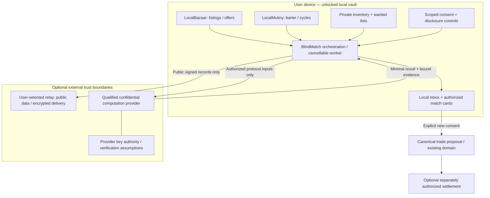
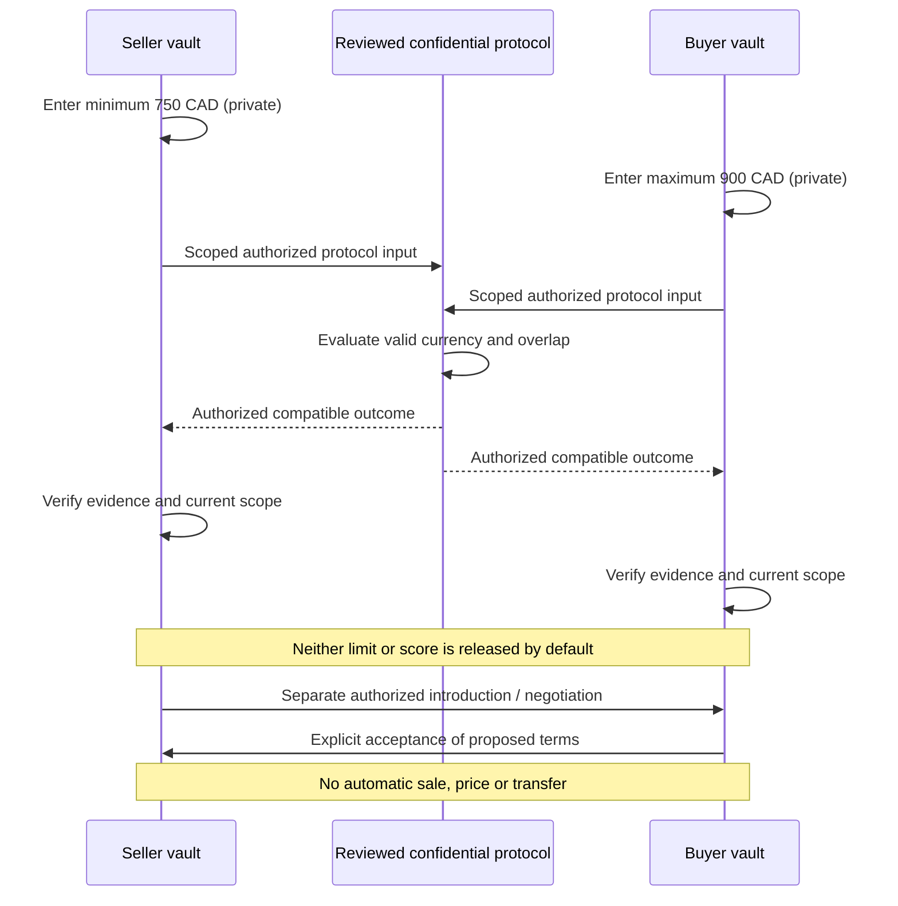
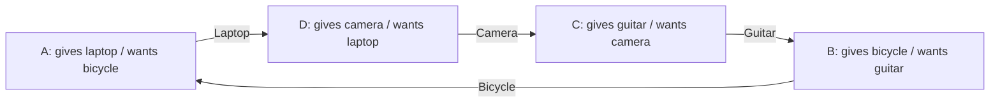
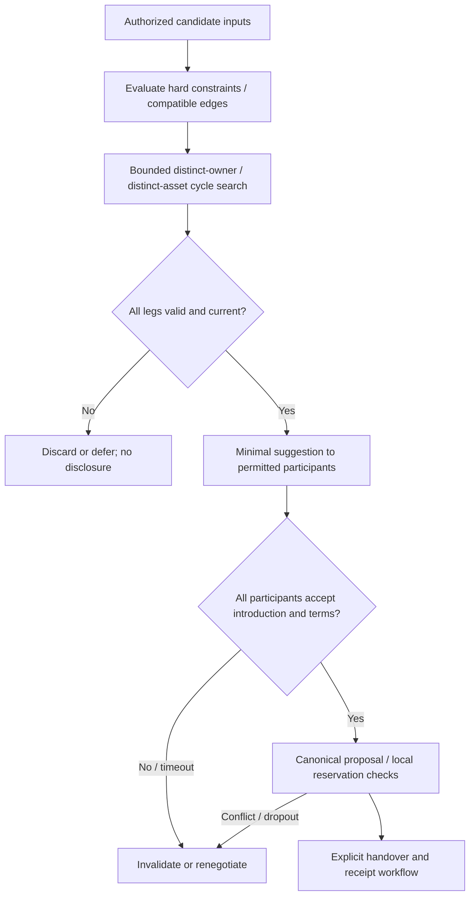
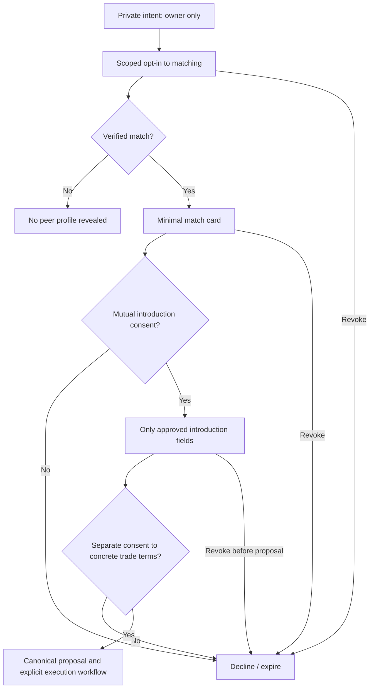
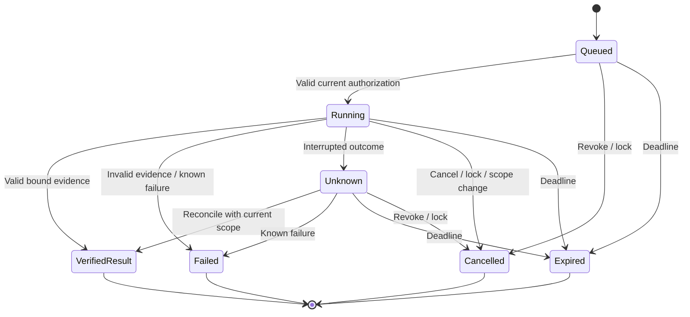
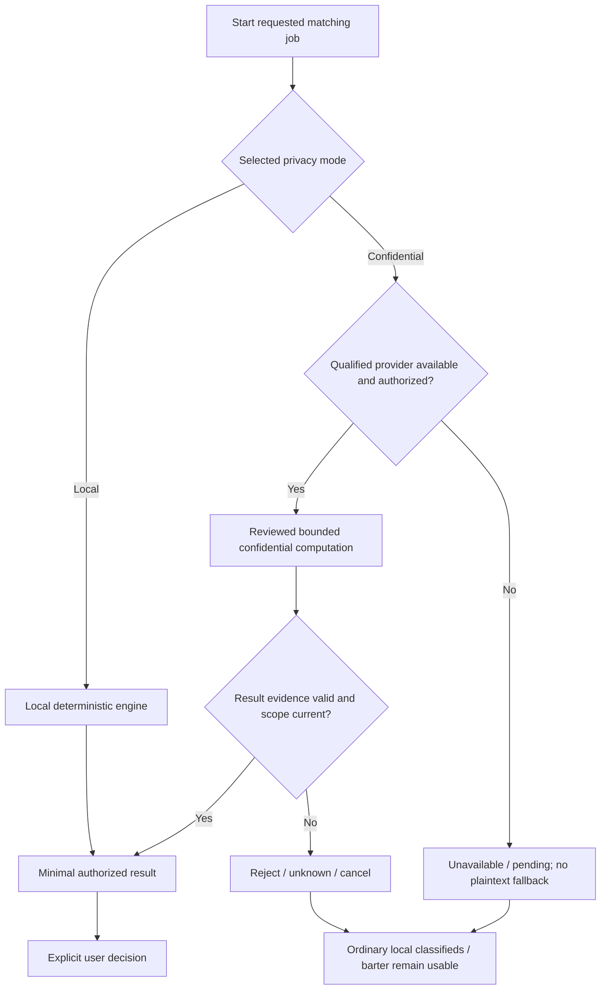
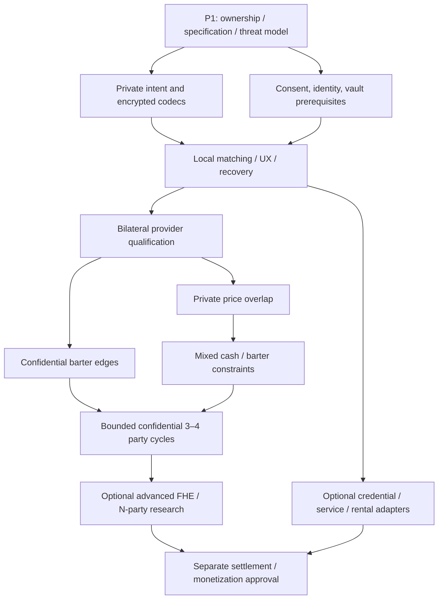

# BlindMatch diagrams

These diagrams describe the proposed architecture, not currently implemented runtime. Mermaid is rendered by GitHub; textual explanations accompany each diagram.

## 1. Composition and trust boundaries

Local matching needs neither a relay nor a chain. Confidential providers are optional and must not be given plaintext private profiles in confidential mode. A suggestion can only become a proposal through an explicit existing-domain operation.

## 2. Bilateral confidential price match

The protocol implementation and key model are not selected. The same example with a maximum below 750 yields an ineligible outcome, not the seller's minimum.

## 3. Four-party cyclic barter

These item names are illustrative. A qualified confidential match reveals only permitted outputs; each participant receives their authorized proposed leg and consent information. Full-cycle disclosure must be expressly authorized where needed for meaningful consent.

## 4. Progressive disclosure

Revocation stops future processing and disclosure to the extent enforceable; it does not recall information already received.

## 5. Job lifecycle

Late callbacks after terminal state or changed revisions are rejected. Reconciliation never grants consent or repeats an uncertain external side effect automatically.

## 6. Provider decision and failure containment

## 7. Feature dependency and delivery order

