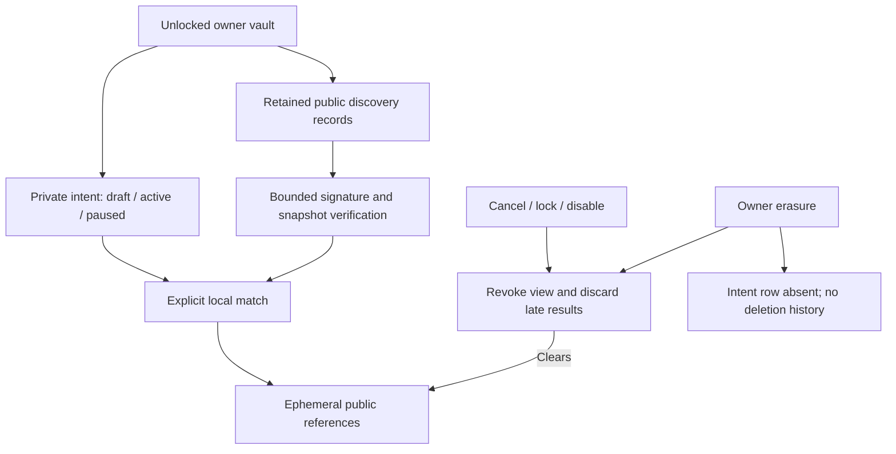
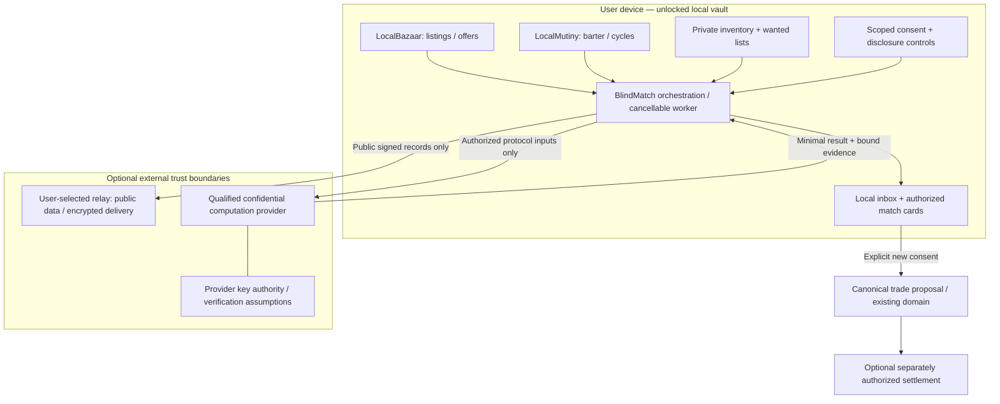
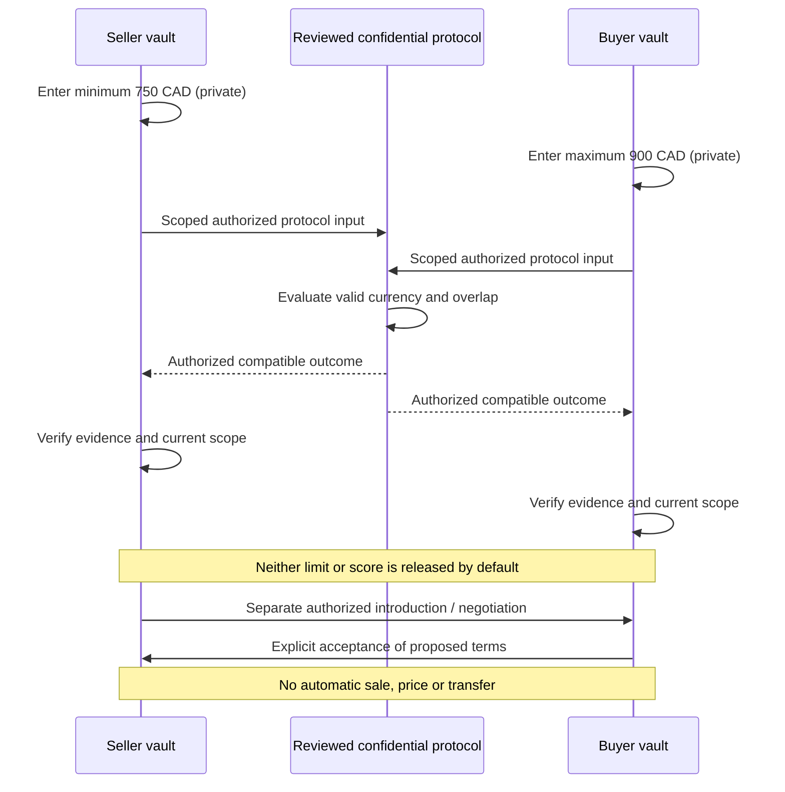
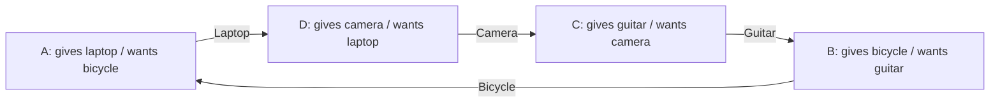
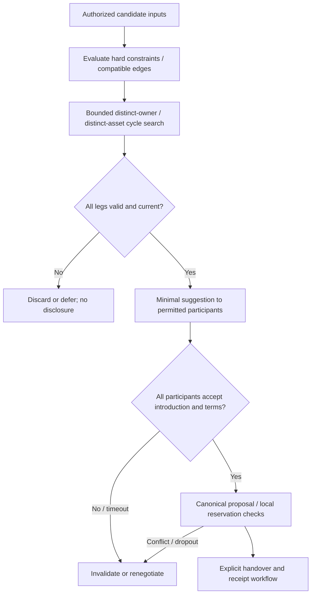
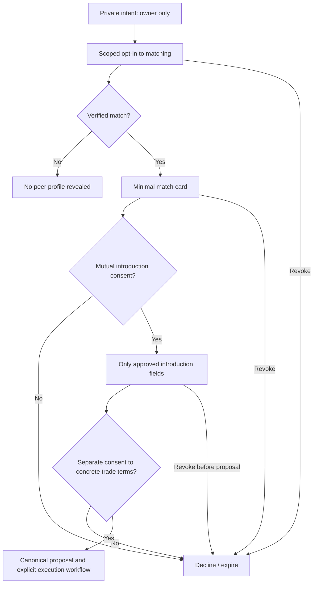
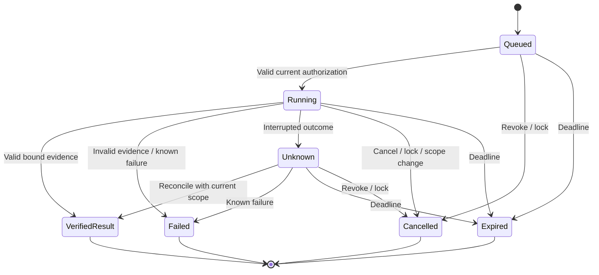
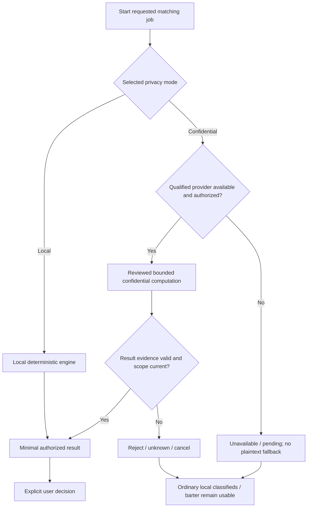
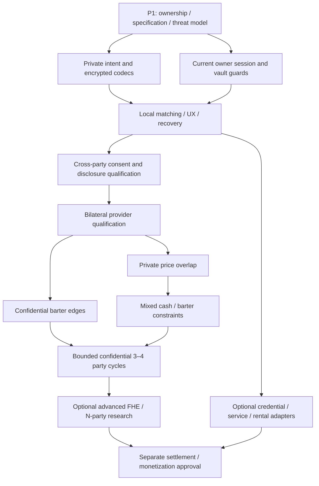

# BlindMatch diagrams

Diagrams 1–7 preserve the published future architecture. They do not imply that
confidential providers, cross-party consent, persistent jobs, inbox delivery,
relay access or a BlindMatch worker are implemented. The bounded current local
path is shown first; its F19 modules remain `FUTURE` and the main launch gate
stays false pending qualification. Mermaid is rendered by GitHub.

## Current local implementation boundary

The adapter receives only a fixed limit and abort signal. It never receives
private criteria and performs no network request. Snapshot verification does not
establish continuing global freshness, trade consent or availability. Restore
returns intent content as draft; no job or result is retained or resumed. The
view is being composed behind an inactive production gate and remains subject to
native, mobile and accessibility acceptance.

## 1. Future composition and trust boundaries

The relay/provider, worker, inbox and proposal paths above are future domain
composition, not part of the current local loader/session. Local matching needs
neither a relay nor a chain. Confidential providers are optional and must not be
given plaintext private profiles in confidential mode. A suggestion can become a
proposal only through a separately authorized existing-domain operation.

## 2. Bilateral confidential price match

The protocol implementation and key model are not selected. The same example with a maximum below 750 yields an ineligible outcome, not the seller's minimum.

## 3. Four-party cyclic barter

These item names are illustrative. A qualified confidential match reveals only permitted outputs; each participant receives their authorized proposed leg and consent information. Full-cycle disclosure must be expressly authorized where needed for meaningful consent.

## 4. Progressive disclosure

Revocation stops future processing and disclosure to the extent enforceable; it does not recall information already received.

## 5. Future remote-job lifecycle

Late callbacks after terminal state or changed revisions are rejected.
Reconciliation never grants consent or repeats an uncertain external side effect
automatically. This diagram does not authorize persistent local jobs, replay
hashes or identifying deletion history. A future external-side-effect recovery
design must first reconcile replay/revocation requirements with owner erasure.
The current local session retains only one ephemeral abort controller.

## 6. Provider decision and failure containment

## 7. Feature dependency and delivery order

The first local path requires the unlocked owner session and explicit local
opt-in, but it performs no cross-party disclosure. Future introduction/provider
paths require their own consent, identity and erasure-compatible recovery
contracts. LocalBazaar and LocalMutiny remain subsequent product releases; their
existing foundations can be reused without activating those future products.
