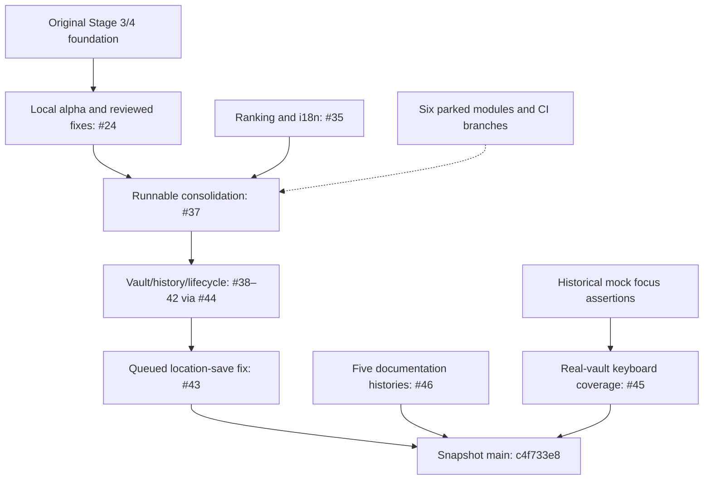

# Exhaustive branch and pull-request consolidation assessment

**Snapshot date:** November 17, 2026, America/Los_Angeles. Git and API timestamps in the JSON retain their original offsets. **Initial main:** [`c4f733e8f2e13c38844acc84b2401209bedf4e24`](https://github.com/djshellshoxxx/CLASSifiedisRUPTed/commit/c4f733e8f2e13c38844acc84b2401209bedf4e24).

This document records the starting source inventory and candidate decisions for the current consolidation. It does not claim that a proposed extraction has passed CI or reached main. The accompanying [machine-readable record](BRANCH_CONSOLIDATION_20261117.json) contains full SHAs, commit dates, ahead/behind counts, original PR snapshots, diff digests, comparison counts and all returned exact-source workflow runs.

## Verified scope

- Canonical repository: [`djshellshoxxx/CLASSifiedisRUPTed`](https://github.com/djshellshoxxx/CLASSifiedisRUPTed). The supplied `djshellshoxxx/Classrupted` path returned 404; the verified repository has ID `1429721366` and matches the existing checkout.
- **52 remote branches including main; 51 development branches; 51 distinct heads.** Thirty development branch heads are already ancestors of main. Six additional parked contributions are integrated by content. Twenty-one branches are not ancestors; this does not mean twenty-one missing features.
- **47 PRs inspected:** 14 previously merged, 32 closed without a direct merge, and one open draft, **#8**. Those counts are prior state, not merges performed by this execution.
- All 47 discussions were inspected. Only #7, #8 and #9 contain automated notices saying the draft was not reviewed. They are not approval or substantive review evidence. The open #8 has no review submissions or inline threads.
- The branch API reports `protected: false`, protection disabled and no required status contexts/checks. The detailed protection endpoint returns 403 for the integration. No protections were altered. Repository CI and the user's explicit verification gates still apply.
- Workflow runs were queried for every live branch head and original PR head, including push and pull-request events. No exact-source result exceeded one 100-run page. "No run" below means no Actions run was returned, not a passing result.

## Material findings beyond the previous PR-only consolidation

### Live branch heads can differ from a closed PR snapshot

| Branch | Closed PR source | Current branch source | New difference | Disposition |
|---|---|---|---|---|
| `claude/happy-newton-4yttpa` | #18: `e402bd56352a` | `8d5f66f75411` | One additional commit; 150 Markdown paths, +10,740/-3,791 lines | Retain as an unadopted specification proposal. Reconcile selected requirements into canonical YAML before regenerating documents. |
| `claude/wonderful-cori-ynhlsb` | #36: `3a5c9e36e22a` | `c9bd8933ff51` | Fifteen additional commits; 1,770 Markdown/CSV paths, +74,879/-49,172 lines | Retain the new proposal checkpoint without overwriting active contracts or generated specifications. |

The older #18/#36 source archives in main remain valid for their pinned snapshots. They do not contain the entire newer branch heads. The new heads are documentation, not missing runtime implementations. The newer wonderful-cori report still refers to decisions as open and declares its own historical NO-GO; those claims must be evaluated against current accepted ADRs rather than applied as new instructions to the runnable alpha. No large duplicate archive is added here.

### Orphan executable work requires an architecture port

`claude/busy-cerf-vg3hz3` at `34a6892cff8babb01c41f42d04df85bf6860fa34` has no PR. Its seven commits change 339 paths, including 202 TypeScript files, with comms, federation, identity, privacy, moderation and platform code plus tests. It is substantive source, not merely a branch-name placeholder.

It uses a synchronous collection/store command pipeline, prefixed ULID records, different signing keys/envelopes and relay-managed identity/directory assumptions. Current main uses scoped asynchronous storage and a user-held encrypted vault. The old messaging code explicitly relies on a relay directory for recipient keys and relay attribution of senders. Importing that tree would require deliberate identity, record, storage and signed-admission adapters; it is not a compatible missing feature package.

The independent security review also found the old blacklist image stripper weaker than the active parser: a JFIF thumbnail survives on the old branch; a minimal invalid JPEG and a bad-CRC PNG are accepted there but rejected by main. These are findings about the unintegrated candidate, not newly discovered main regressions. Preserve current image handling and review reusable behavioral tests alongside any future port.

### The unmerged CLI proposal is useful after correction

`planning/future-cli-specs-20261110` at `af4dcc546e6342fb34d717d4050b52b8ffe7ffa3` adds a future CLI proposal absent from the snapshot main. Its original text incorrectly assigns user authority to servers. The [adapted proposal](../future-cli-spec.md) preserves command families, automation behavior and acceptance goals while using ADR-0016 vault authority, explicit encrypted working copies and optional relay scope. It distinguishes existing setup tools from unimplemented domain commands. This is a specification extraction, not domain-CLI completion.

### Existing content integration remains intact

The six parked module/CI branches were compared again against this snapshot: **66 changed paths exist on main; 38 are byte-identical, 28 retain later corrections, none are missing.** Exact file classifications are in the JSON. The [prior complete code comparison](../reviews/20261117-pr-consolidation/parked-modules-review.md) explains the later consent, PNG, rate-limit, clock, search and CI fixes. Ancestry and `git cherry` alone would misclassify this already-integrated work.

### PR #8 retains a bounded extraction path

PR #8 head `a403614bb34d3d176d4693730e512e14959718b8` still contains unique code after its original `3694395` foundation was inherited by the alpha. The [source-pinned runtime review](../reviews/20261117-pr-consolidation/pr8-runtime-review.md) records 86 TypeScript diagnostics and 73 failing tests out of 93 at that exact old head. These are previously executed results, not reruns in this inventory task.

The broken transaction replacement, removed exports and missing generated files prevent a blanket merge. Feature-registry generation and queries are the first isolated candidate. A port must supply the missing artifact, bounds, immutability, dependency validation, query authorization, regression tests and build/CI checks without substituting the old storage or cryptographic formats. The remaining public-ID, canonical-signature, secret-adapter and storage changes keep separate migration and verification requirements. This report does not pre-claim the registry candidate as integrated.

## Dependency graph

Solid edges show prerequisite lineage or integration stages. The dotted edge marks content integration, where original branch heads are not ancestors.

The remaining #8 runtime, busy-cerf implementation and advanced specification drafts are not prerequisites for the current runnable alpha. Each proposed port must use the current main interfaces. The CLI proposal depends on accepted architecture, not on the old relay runtime.

## Every remote branch

The table is exhaustive for the fetched starting snapshot. `+/-` means commits ahead of/behind main. A short SHA is shown for readability; full SHAs and source dates are in the JSON. Risk describes a wholesale replay of the old branch, not a vulnerability rating of current main.

| Branch | Head; ahead/behind | PR | Actual contribution | Decision / result | Risk | CI on exact head |
|---|---|---|---|---|---|---|
| `agents/ci/trim-workflows` | `3f41b81accf0`; +1/-117 | #33 | Change-aware CI matrices and duplicate-run control | Superseded; contribution integrated by content | High | No run |
| `agents/discovery/coarse-filters` | `4f60ff9fa121`; +2/-117 | #26 | Coarse geohash regions and search filters | Superseded; contribution integrated by content | High | No run |
| `agents/discovery/ranking` | `de8f44d52cfc`; +0/-115 | #27 | Relevance ranking and fairness | Superseded; full head ancestor | Low | No run |
| `agents/governance/taxonomy-prohibited` | `997249164e4b`; +2/-117 | #30 | Goods taxonomy and prohibited-item policy | Superseded; contribution integrated by content | High | No run |
| `agents/i18n/languages-currencies` | `a0f9422d91b9`; +0/-115 | #28 | Language and currency display | Superseded; full head ancestor | Low | No run |
| `agents/moderation/rate-limits-signals` | `c098f1bf9175`; +2/-117 | #32 | Rate limits, account limits and risk signals | Superseded; contribution integrated by content | High | No run |
| `agents/notify/prefs-inapp` | `d6076d18621e`; +2/-117 | #29 | Channel consent, local preferences and inbox | Superseded; contribution integrated by content | High | No run |
| `agents/orchestration/wave1-handoff` | `6406a0369098`; +0/-116 | #34 | Historical wave-one handoff and coordination records | Superseded; full head ancestor | Low | No run |
| `agents/privacy/classification-metadata-consent` | `2752f04dd27c`; +2/-117 | #31 | Data classification and image/network metadata minimization | Superseded; contribution integrated by content | High | No run |
| `chatgpt/zero-codex-continuation-spec-20261109` | `d52b29369271`; +0/-175 | #11 | Historical continuation specification | Superseded; full head ancestor | Low | No run |
| `chatgpt/zero-codex/audit-observability-20261110` | `1ee040492345`; +0/-163 | #14 | Source-pinned observability audit record | Superseded; full head ancestor | Low | No run |
| `chatgpt/zero-codex/barter-discovery-status-20261110` | `e0f153fd9185`; +0/-142 | #20 | Live status announcements for barter discovery | Superseded; full head ancestor | Low | Alpha: success; CLI: success; cancelled runs retained |
| `chatgpt/zero-codex/cli-nested-assets-20261110` | `3a66e440847d`; +0/-141 | #19 | Nested symlink public-asset regressions | Superseded; full head ancestor | Low | Alpha: success; CLI: success; cancelled runs retained |
| `chatgpt/zero-codex/cli-public-symlink-20261110` | `f8ed3a9324de`; +0/-142 | #17 | Fail-closed public-asset symlink handling | Superseded; full head ancestor | Low | Alpha: success; CLI: success; cancelled runs retained |
| `chatgpt/zero-codex/diagnostic-privacy-regression-20261110` | `9bb03390b269`; +0/-142 | #22 | Diagnostic message and Error-detail redaction | Superseded; full head ancestor | Low | Alpha: success; CLI: success; cancelled runs retained |
| `chatgpt/zero-codex/docs-wiki-20261110` | `19edded385d4`; +0/-140 | #13 | User/developer wiki source and navigation | Superseded; full head ancestor | Low | No run |
| `chatgpt/zero-codex/federation-recovery-trace-20261110` | `20691f1cce36`; +0/-143 | #15 | Federation/recovery acceptance and gap map | Superseded; full head ancestor | Low | Alpha: success; CLI: success; cancelled runs retained |
| `chatgpt/zero-codex/noscript-vault-guard-20261110` | `968d63d8aeba`; +0/-141 | #21 | Vault access guard when scripts are disabled | Superseded; full head ancestor | Low | Alpha: success; CLI: success; cancelled runs retained |
| `chatgpt/zero-codex/outbox-isolation-20261110` | `a294dd21715e`; +0/-142 | #16 | Retry isolation by tenant, type and aggregate | Superseded; full head ancestor | Low | Alpha: success; CLI: success; cancelled runs retained |
| `chatgpt/zero-codex/qualify-pr10-20261110` | `4620d244e79e`; +0/-156 | #12 | Historical alpha CI qualification ledger | Superseded; full head ancestor | Low | No run |
| `chatgpt/zero-codex/review-ranking-i18n-20261112` | `d16abeef4dfa`; +0/-112 | #35 | Integration of ranking, i18n and exact listing values | Superseded; full head ancestor | Low | Alpha: success; CLI: success; cancelled runs retained |
| `chatgpt/zero-codex/sync-expiry-head-boundary-20261110` | `12558435a307`; +0/-142 | #23 | Expiry recheck at queued transport dispatch | Superseded; full head ancestor | Low | Alpha: success; CLI: success; cancelled runs retained |
| `claude/bold-mccarthy-qklhl6` | `a403614bb34d`; +31/-146 | #8 | Stage 3/4 foundation plus unfinished kernel/security/platform changes | Extract / Repair; earlier foundation integrated unique work pending | High | No run |
| `claude/busy-cerf-vg3hz3` | `34a6892cff8b`; +7/-176 | — | Separate relay/kernel implementation with comms, identity, privacy and federation | Defer; alternative runtime unintegrated | High | No run |
| `claude/classifiedisrupted-continue-lcuuwg` | `ab6541552827`; +56/-176 | #5 | Mock UI continuation and accessibility checks | Superseded; historical source preserved | High | No run |
| `claude/difficult-project-parts-dcqlup` | `566778cdf723`; +0/-143 | #25 | Historical hard-slice subsystem maps and candidate designs | Superseded; full head ancestor | Low | Alpha: success; CLI: success; cancelled runs retained |
| `claude/gallant-goodall-9cc7yb` | `cc55f8ad1534`; +1/-176 | — | Historical RESUME_STATE recovery note | Superseded; historical status preserved | Low | No run |
| `claude/happy-newton-4yttpa` | `8d5f66f75411`; +3/-176 | #18 | Hand-written services, rentals, accessibility and governance specifications | Defer; newer unadopted specification checkpoint | Medium | No run |
| `claude/pensive-mendel-30x81m` | `52bed39dda52`; +1/-176 | #3 | Original synthetic-data mock application | Superseded; historical source preserved | High | No run |
| `claude/vigilant-newton-nva2l6` | `59028d1d962e`; +2/-176 | #6 | Historical planning README/TODO and handoff | Superseded; historical status preserved | Low | No run |
| `claude/wonderful-cori-ynhlsb` | `c9bd8933ff51`; +24/-171 | #36 | Hand-written Stage 3 process/contract drafts and NO-GO audit | Defer; newer unadopted specification checkpoint | Medium | No run |
| `codex/classrup-completion-20261116` | `a189787ab6cc`; +0/-99 | #37 | Runnable local alpha, editor/search/inbox and audited module integration | Superseded; full head ancestor | Low | Alpha: success; CLI: success |
| `codex/classrup-consolidation-audit-20261104` | `59324a42e2dd`; +0/-175 | #9 | Historical branch consolidation assessment | Superseded; full head ancestor | Low | No run |
| `codex/classrup-features-20261116` | `560b328dd335`; +0/-90 | #41 | Owner archive/recovery and listing pagination | Superseded; full head ancestor | Low | Alpha: success; CLI: success |
| `codex/consolidate-keyboard-focus-20261117` | `0c2e9e2992c3`; +0/-76 | #45 | Visible keyboard-focus assertions in real-vault browser journeys | Superseded; full head ancestor | Low | Alpha: success; CLI: success |
| `codex/encrypted-domain-storage-20261116` | `afa6952b50d9`; +0/-96 | #38 | Encrypted local domain storage and tamper rejection | Superseded; full head ancestor | Low | Alpha: success; CLI: success |
| `codex/listing-history-20261116` | `3f814c03a8c0`; +0/-94 | #39 | Verified owner listing history and backup support | Superseded; full head ancestor | Low | Alpha: success; CLI: failure |
| `codex/local-alpha-20261109` | `429fcfca9735`; +0/-144 | #10 | Initial local vault, signed listings, barter and setup CLI | Superseded; full head ancestor | Low | Alpha: success; CLI: success; cancelled runs retained |
| `codex/parallel-completion-20261116` | `64cfc398ea3b`; +0/-81 | #43, #42 | Listing lifecycle, sessions, location, matching, money/consent foundations and queued-save fix | Superseded; full head ancestor | Low | Alpha: success; CLI: success; cancelled runs retained |
| `codex/verified-status-20261116` | `edcb583afc2c`; +0/-93 | #40 | Executed feature inventory and continuation status | Superseded; full head ancestor | Low | No run |
| `continuation/classrup-20261101` | `fa0cf0c33c80`; +61/-176 | — | Historical mock lineage plus failed-storage-write session fix | Superseded; historical source preserved | High | No run |
| `docs/client-owned-foundations-20261024` | `d804b49d262b`; +38/-176 | #2 | Early client-owned architecture and contract drafts | Superseded; historical source preserved | High | No run |
| `docs/pr-consolidation-results-20261117` | `f75baf6240d2`; +0/-1 | #47 | Prior consolidation outcome and qualification record | Superseded; full head ancestor | Low | No run |
| `docs/prompt3-foundations-20261022` | `39ac84787074`; +34/-176 | #1 | Original contract and specification NO-GO drafts | Superseded; historical source preserved | High | No run |
| `integration/classrup-completion` | `75d4bf51433e`; +0/-117 | #24 | Kernel/local-alpha integration and reviewed corrective fixes | Superseded; full head ancestor | Low | Alpha: success; CLI: success; cancelled runs retained |
| `integration/pr-docs-consolidation-20261117` | `43fb20ffd6c7`; +0/-6 | #46 | Five documentation histories and proposal archives | Superseded; full head ancestor | Low | Alpha: success; CLI: success |
| `integration/qualified-listing-vault-stack-20261116` | `d020237d6acf`; +0/-82 | #44 | Qualified listing/history/vault/lifecycle checkpoint | Superseded; full head ancestor | Low | Alpha: success; CLI: success; cancelled runs retained |
| `main` | `c4f733e8f2e1`; +0/-0 | — | Canonical runnable local-alpha baseline | Baseline; baseline | Low | No run |
| `milestone/framework-browser-verification` | `25fa6f0a9972`; +59/-176 | #7 | Chromium/Firefox/WebKit mock-application checks | Superseded; historical source preserved | High | Mock: success |
| `planning/future-cli-specs-20261110` | `af4dcc546e63`; +1/-176 | — | Future domain CLI proposal | Extract; adapted document candidate | Low | No run |
| `work/classrup-framework` | `52bed39dda52`; +1/-176 | — | Alias of original synthetic-data mock application | Superseded; historical source preserved | High | No run |
| `work/classrup-haiku-framework` | `0ac7f962aaa6`; +52/-176 | #4 | Mock framework and planning checkpoint | Superseded; historical source preserved | High | No run |

## Every pull request

These are original PR head snapshots. In particular, #18 and #36 do not track their later live branch heads after closure. "Closed without direct merge" may still mean exact ancestry through another integration, content integration, or an explicitly archived/superseded proposal.

| PR | Snapshot head | State | Changed paths | Disposition |
|---|---|---|---|---|
| [#1](https://github.com/djshellshoxxx/CLASSifiedisRUPTed/pull/1) | `39ac84787074` | closed unmerged | 29 | Closed; historical planning/mock source superseded |
| [#2](https://github.com/djshellshoxxx/CLASSifiedisRUPTed/pull/2) | `d804b49d262b` | closed unmerged | 371 | Closed; historical planning/mock source superseded |
| [#3](https://github.com/djshellshoxxx/CLASSifiedisRUPTed/pull/3) | `52bed39dda52` | closed unmerged | 25 | Closed; historical planning/mock source superseded |
| [#4](https://github.com/djshellshoxxx/CLASSifiedisRUPTed/pull/4) | `0ac7f962aaa6` | closed unmerged | 406 | Closed; historical planning/mock source superseded |
| [#5](https://github.com/djshellshoxxx/CLASSifiedisRUPTed/pull/5) | `ab6541552827` | closed unmerged | 409 | Closed; historical planning/mock source superseded |
| [#6](https://github.com/djshellshoxxx/CLASSifiedisRUPTed/pull/6) | `59028d1d962e` | closed unmerged | 4 | Closed; historical planning/mock source superseded |
| [#7](https://github.com/djshellshoxxx/CLASSifiedisRUPTed/pull/7) | `25fa6f0a9972` | closed unmerged | 24 | Closed; historical planning/mock source superseded |
| [#8](https://github.com/djshellshoxxx/CLASSifiedisRUPTed/pull/8) | `a403614bb34d` | open draft | 2281 | Open draft; isolated extraction/repair required |
| [#9](https://github.com/djshellshoxxx/CLASSifiedisRUPTed/pull/9) | `59324a42e2dd` | merged | 1 | Merged by ancestry |
| [#10](https://github.com/djshellshoxxx/CLASSifiedisRUPTed/pull/10) | `429fcfca9735` | closed unmerged | 88 | Closed; exact source already integrated |
| [#11](https://github.com/djshellshoxxx/CLASSifiedisRUPTed/pull/11) | `d52b29369271` | merged | 1 | Merged by ancestry |
| [#12](https://github.com/djshellshoxxx/CLASSifiedisRUPTed/pull/12) | `4620d244e79e` | merged | 1 | Merged by ancestry |
| [#13](https://github.com/djshellshoxxx/CLASSifiedisRUPTed/pull/13) | `19edded385d4` | merged | 6 | Merged by ancestry |
| [#14](https://github.com/djshellshoxxx/CLASSifiedisRUPTed/pull/14) | `1ee040492345` | merged | 1 | Merged by ancestry |
| [#15](https://github.com/djshellshoxxx/CLASSifiedisRUPTed/pull/15) | `20691f1cce36` | closed unmerged | 1 | Closed; exact source already integrated |
| [#16](https://github.com/djshellshoxxx/CLASSifiedisRUPTed/pull/16) | `a294dd21715e` | closed unmerged | 4 | Closed; exact source already integrated |
| [#17](https://github.com/djshellshoxxx/CLASSifiedisRUPTed/pull/17) | `f8ed3a9324de` | closed unmerged | 2 | Closed; exact source already integrated |
| [#18](https://github.com/djshellshoxxx/CLASSifiedisRUPTed/pull/18) | `e402bd56352a` | closed unmerged | 20 | Closed; original proposal archived, later branch work deferred |
| [#19](https://github.com/djshellshoxxx/CLASSifiedisRUPTed/pull/19) | `3a66e440847d` | closed unmerged | 1 | Closed; exact source already integrated |
| [#20](https://github.com/djshellshoxxx/CLASSifiedisRUPTed/pull/20) | `e0f153fd9185` | closed unmerged | 2 | Closed; exact source already integrated |
| [#21](https://github.com/djshellshoxxx/CLASSifiedisRUPTed/pull/21) | `968d63d8aeba` | closed unmerged | 3 | Closed; exact source already integrated |
| [#22](https://github.com/djshellshoxxx/CLASSifiedisRUPTed/pull/22) | `9bb03390b269` | closed unmerged | 2 | Closed; exact source already integrated |
| [#23](https://github.com/djshellshoxxx/CLASSifiedisRUPTed/pull/23) | `12558435a307` | closed unmerged | 2 | Closed; exact source already integrated |
| [#24](https://github.com/djshellshoxxx/CLASSifiedisRUPTed/pull/24) | `75d4bf51433e` | merged | 2309 | Merged by ancestry |
| [#25](https://github.com/djshellshoxxx/CLASSifiedisRUPTed/pull/25) | `566778cdf723` | closed unmerged | 25 | Closed; exact source already integrated |
| [#26](https://github.com/djshellshoxxx/CLASSifiedisRUPTed/pull/26) | `4f60ff9fa121` | closed unmerged | 9 | Closed; original contribution integrated by content |
| [#27](https://github.com/djshellshoxxx/CLASSifiedisRUPTed/pull/27) | `de8f44d52cfc` | closed unmerged | 7 | Closed; exact source already integrated |
| [#28](https://github.com/djshellshoxxx/CLASSifiedisRUPTed/pull/28) | `a0f9422d91b9` | closed unmerged | 8 | Closed; exact source already integrated |
| [#29](https://github.com/djshellshoxxx/CLASSifiedisRUPTed/pull/29) | `d6076d18621e` | closed unmerged | 10 | Closed; original contribution integrated by content |
| [#30](https://github.com/djshellshoxxx/CLASSifiedisRUPTed/pull/30) | `997249164e4b` | closed unmerged | 14 | Closed; original contribution integrated by content |
| [#31](https://github.com/djshellshoxxx/CLASSifiedisRUPTed/pull/31) | `2752f04dd27c` | closed unmerged | 19 | Closed; original contribution integrated by content |
| [#32](https://github.com/djshellshoxxx/CLASSifiedisRUPTed/pull/32) | `c098f1bf9175` | closed unmerged | 10 | Closed; original contribution integrated by content |
| [#33](https://github.com/djshellshoxxx/CLASSifiedisRUPTed/pull/33) | `3f41b81accf0` | closed unmerged | 4 | Closed; original contribution integrated by content |
| [#34](https://github.com/djshellshoxxx/CLASSifiedisRUPTed/pull/34) | `6406a0369098` | closed unmerged | 14 | Closed; exact source already integrated |
| [#35](https://github.com/djshellshoxxx/CLASSifiedisRUPTed/pull/35) | `d16abeef4dfa` | closed unmerged | 27 | Closed; exact source already integrated |
| [#36](https://github.com/djshellshoxxx/CLASSifiedisRUPTed/pull/36) | `3a5c9e36e22a` | closed unmerged | 169 | Closed; original proposal archived, later branch work deferred |
| [#37](https://github.com/djshellshoxxx/CLASSifiedisRUPTed/pull/37) | `a189787ab6cc` | merged | 2428 | Merged by ancestry |
| [#38](https://github.com/djshellshoxxx/CLASSifiedisRUPTed/pull/38) | `afa6952b50d9` | merged | 11 | Merged by ancestry |
| [#39](https://github.com/djshellshoxxx/CLASSifiedisRUPTed/pull/39) | `3f814c03a8c0` | merged | 13 | Merged by ancestry |
| [#40](https://github.com/djshellshoxxx/CLASSifiedisRUPTed/pull/40) | `edcb583afc2c` | closed unmerged | 4 | Closed; exact source already integrated |
| [#41](https://github.com/djshellshoxxx/CLASSifiedisRUPTed/pull/41) | `560b328dd335` | closed unmerged | 11 | Closed; exact source already integrated |
| [#42](https://github.com/djshellshoxxx/CLASSifiedisRUPTed/pull/42) | `64cfc398ea3b` | closed unmerged | 96 | Closed; exact source already integrated |
| [#43](https://github.com/djshellshoxxx/CLASSifiedisRUPTed/pull/43) | `64cfc398ea3b` | merged | 101 | Merged by ancestry |
| [#44](https://github.com/djshellshoxxx/CLASSifiedisRUPTed/pull/44) | `d020237d6acf` | merged | 101 | Merged by ancestry |
| [#45](https://github.com/djshellshoxxx/CLASSifiedisRUPTed/pull/45) | `0c2e9e2992c3` | merged | 1 | Merged by ancestry |
| [#46](https://github.com/djshellshoxxx/CLASSifiedisRUPTed/pull/46) | `43fb20ffd6c7` | merged | 72 | Merged by ancestry |
| [#47](https://github.com/djshellshoxxx/CLASSifiedisRUPTed/pull/47) | `f75baf6240d2` | merged | 5 | Merged by ancestry |

## CI evidence and limits

- Snapshot main has no exact-head Actions run. It is the documentation-only #47 merge; its workflows ignore Markdown and `docs/**`. No exact-main green check is fabricated.
- PR #37 head `a189787ab6cc` has successful [Alpha 43889531898](https://github.com/djshellshoxxx/CLASSifiedisRUPTed/actions/runs/43889531898) and [CLI 43889532000](https://github.com/djshellshoxxx/CLASSifiedisRUPTed/actions/runs/43889532000) runs. Its former startup failure is not an unresolved PR status.
- The corrected #45 head `0c2e9e2992c3` has successful [Alpha 44227269816](https://github.com/djshellshoxxx/CLASSifiedisRUPTed/actions/runs/44227269816) and [CLI 44227269875](https://github.com/djshellshoxxx/CLASSifiedisRUPTed/actions/runs/44227269875) runs. Existing source-pinned records report 66 browser journeys. A fresh test run, if performed by the integration team, needs its own source and result record.
- The #43 head `64cfc398ea3b` has successful [Alpha 43981540981](https://github.com/djshellshoxxx/CLASSifiedisRUPTed/actions/runs/43981540981) and [CLI 43981539765](https://github.com/djshellshoxxx/CLASSifiedisRUPTed/actions/runs/43981539765) runs as well as cancelled duplicate runs. Cancelled runs remain in the JSON rather than being silently erased.
- Historical #39 head `3f814c03a8c0` has Alpha success and a CLI failure. Its later integrated stack and queued-save head have subsequent successful qualification. The old failure is retained as old-source evidence, not re-labelled green.
- No Actions run was returned for #8 or the busy-cerf orphan. A branch with no run is not qualified by this inventory.

## Recommended integration order and remaining blockers

1. Keep the current encrypted-vault/runtime baseline and finish any reproduced current-main defect independently. Do not reintroduce the obsolete mock application or old kernel to resolve history differences.
2. Land the architecture-corrected future CLI specification and this complete source inventory as documentation once reviewed. It creates no user-data migration or runtime capability.
3. Qualify the isolated feature-registry candidate from #8 with current contracts and meaningful negative tests. Merge only after the current candidate and combined tree pass the applicable gates; keep #8 open for the other unique work.
4. Reconcile further #8 features one by one: public IDs need a stable-record migration boundary; canonical signatures need versioned admission and independent vectors; optional relay secrets need a real consumer; storage changes need all adapters, encrypted-vault compatibility and rollback evidence.
5. Port a busy-cerf workflow only after designing the user-held identity, async storage, signed provenance and backup adapters for that specific workflow. Use its behavioral tests as references, while preserving stronger current parser and privacy controls.
6. Review advanced happy/wonderful requirements against current YAML/contracts in bounded feature-specific work. Keep their pinned original sources, and do not copy their generated documents over canonical output or treat their old open decisions as current authority.

## Verification of this inventory

Commands used include `git ls-remote`, complete branch/pull-ref fetches, `git for-each-ref`, `git rev-list --left-right --count`, `git merge-base --is-ancestor`, `git cherry`, `git diff --name-only`, `git diff --binary`, and Git blob equality. Every source diff has a SHA-256 digest in the JSON. Branch classification is supported by source content and existing fixed-source reviews, not names or ahead counts alone.

The adapted CLI proposal was compared to the real setup help, package scripts, ADR-0016 and current domain entrypoints. JSON coverage and internal document links are checked locally; no runtime test result is implied by these documentation checks. Remote branches and PRs are unchanged by the inventory task.

### Reproducible baseline counts

| Measure | Count |
|---|---:|
| remote branches including main | 52 |
| non main branches | 51 |
| distinct remote heads | 51 |
| non main heads already ancestors | 30 |
| additional contributions already integrated by content | 6 |
| non ancestor branches | 21 |
| pull requests | 47 |
| merged prs at snapshot | 14 |
| closed unmerged prs at snapshot | 32 |
| parked changed paths | 66 |
| parked identical paths | 38 |
| parked modified paths | 28 |
| parked missing paths | 0 |

The counts describe the initial snapshot. New integration branches or PRs created during execution belong in the final execution report rather than being retrospectively counted as original contributions.
