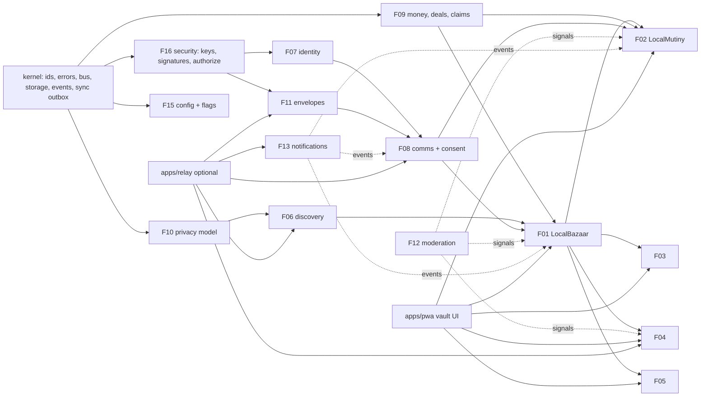
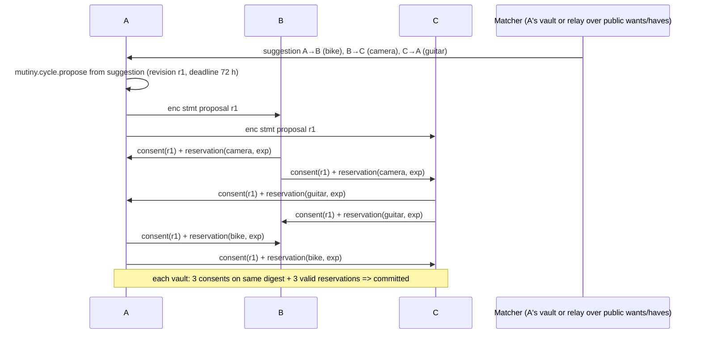

# Reference end-to-end flows

**Status:** SPECIFIED (Stage 3). Architecture: ADR-0016 local-first hybrid. Every arrow labelled *stmt* is a signed CTR-FED-001 envelope; *enc* means end-to-end encrypted to the named recipients (PRV-5). `R` is an optional user-selected relay; where marked *direct*, the flow also works by exchanging envelopes as files/QR without a relay. States follow [CONSISTENCY_STATES.md](CONSISTENCY_STATES.md). Integration tests F17.S01.M03 implement each flow as `FLOW-nn` with one in-memory vault per participant plus an in-process relay.

## Dependency overview



## FLOW-01 Paid classified listing
Seller drafts a listing (F01.S01.M01) and chooses promotion on relay R whose hosting policy (relay-local) charges a fee.
1. Seller vault: `bazaar.listing.create` → draft (P3, local committed). `bazaar.listing.publish` runs F18.S01.M02 prohibited-item rules and F12.S02.M02 spam heuristics locally, produces the public projection (P0, L2 cell, EXIF stripped) *stmt* → R.
2. R verifies signature, applies its hosting policy and returns a relay-signed receipt (transport acknowledged). Promotion requires a fee: R issues a payment request; seller makes an external payment and records a `PaymentClaim` (F09.S01.M01, method crypto/external).
3. R marks the listing *Promoted* only after the claim is `final` (crypto, COM-5) or `acknowledged` by the relay operator (external). The ranking label "Promoted" is applied by R (F06.S03.M01/M02 caps ≤ 20 % per page).
4. Failure: claim reorged or expired → R removes promotion, listing stays published; seller sees the claim state, never "paid".

## FLOW-02 Ordinary local sale
```mermaid
sequenceDiagram
  participant B as Buyer vault
  participant R as Relay (optional)
  participant S as Seller vault
  B->>R: search query (L2 cells, buckets)
  R-->>B: public projections (signed by S)
  B->>B: bazaar.offer.make (local committed)
  B->>R: enc stmt offer
  R->>S: mailbox fetch
  S->>S: verify signer=buyer, accept: hold + Deal (one tx)
  S->>R: enc stmt acceptance
  R->>B: mailbox fetch
  B->>B: verify signer=listing author, Deal mirrored
  B->>S: meetup proposal (F08.S03.M03) enc stmt
  S->>B: payment acknowledged (cash) stmt
  B->>S: receipt attestation stmt; both: deal completed
```
Edge: buyer withdrew before acceptance delivered → both vaults resolve to withdrawn-before-accept and release the hold (F01.S04.M01 offline rule).

## FLOW-03 Two-party barter
1. A browses B's listing and proposes `mutiny.proposal.create` (F02.S01.M01) with legs A→B item X, B→A item Y, declared values (F02.S04.M03) and settlement currency.
2. F02.S02.M05 feasibility runs in A's vault (ownership claims, value tolerance MNY-5, blocks). Proposal revision r1 digest = SHA-256(JCS(proposal)).
3. A signs consent on r1 (F08.S02.M02 `comms.consent.sign`) and sends *enc stmt* to B. B may counter (F02.S01.M04) → r2 voids all consents. B signs r2; A signs r2.
4. Each vault places a local reservation on its own item (F01.S03.M01 hold) and sends a signed reservation statement with expiry (IDM-8). Commit when both consents on the same digest and both reservations are valid in each vault's view.
5. Handover attestations (F02.S03.M04): giver "handed over", receiver "received" per leg → completed. Reviews enabled (F07.S03.M01).

## FLOW-04 Three-party cycle

Then per-leg handover/receipt attestations; all three receipts → completed.

## FLOW-05 Four-party cycle
As FLOW-04 with participants A→B→C→D→A. F02.S02.M02 profile applies stricter tolerance (value imbalance ≤ 5 % of the larger side per leg) and maximum distance bucket 10–25 km. Commit requires 4 consents + 4 reservations in every vault's view. Dropout of D before any handover (F02.S03.M03): D's withdrawal *stmt* or reservation expiry → every vault cancels, releases its own reservation; matcher may suggest a new 3-cycle, which is a **new proposal requiring fresh consent** (no silent reroute).

## FLOW-06 Generalized N-party cycle
Engine F02.S02.M03 enumerates elementary cycles length 2..Lmax (default 5, max 8) over the compatibility graph with budgets (≤ 100 000 expansions, ≤ 250 ms), deterministic order and greedy disjoint selection (ADR-0005). For N participants the proposal carries N legs; commit requires N consents and N reservations; messages are O(N²) envelopes when direct, O(N) via a relay mailbox fan-out. Deadline default 72 h; any vault whose clock passes the deadline before commit treats the cycle as expired.

## FLOW-07 Mixed-value barter compensation
In FLOW-03/04, normalized values (F02.S04.M02, pinned FxQuote id, expiry 15 min) differ by more than tolerance. Proposal adds a CompensationLeg (F02.S04.M01): payer → payee amount in settlement currency. Consent covers the leg. After commit, the payer records a PaymentClaim; the cycle reaches completed only when all item receipts are attested **and** the compensation claim is `acknowledged` (cash/external) or `final` (crypto). Quote expiry before commit → `EXPIRED`, re-quote, new revision, fresh consent.

## FLOW-08 Cancellation and dispute
1. Partial handover: in a 3-cycle, A→B received, B→C handed over but C reports "not received". Cycle → `partially_executed` (F02.S03.M04).
2. Recovery options offered to all: return items, compensation leg, or dispute. C opens `commerce.dispute.open` (F09.S02.M02) with evidence refs (photos, meetup check-ins F08.S03.M02).
3. Parties may jointly select a mediator (a moderator on a relay both trust). Outcome is a signed statement (e.g. return-agreed); it cannot move money or items. Unresolved after 30 days → closed-unresolved; reputation reviews unlocked with dispute flag.

## FLOW-09 Fraud and moderation
1. User reports a listing on relay R (F12.S01.M01): report stmt + evidence snapshot hash (F12.S01.M02).
2. R's moderators review under R's published policy (F12.S02.M03 rule IDs) and remove the listing from R's index with a statement of reasons (F12.S02.M01). The author may appeal to R within 30 days (F12.S01.M03), reviewed by a different moderator.
3. Locally, any user can hide/block (F07.S02.M02) and subscribe to R's signed advisory feed. Fraud signals (fake payment claims, shill bids) feed explainable risk levels that add friction (F12.S03.M01); no global suspension exists.

## FLOW-10 Private messages
Thread bound to a context (F08.S01.M02). Sender vault encrypts with x25519 + XChaCha20-Poly1305 per-recipient wrapped keys (F08.S01.M01), posts *enc* envelope to recipient mailbox on R; R stores ciphertext and routing metadata only (mailbox ID, size, time). Recipient fetches, decrypts, sends delivery ack (optional). Attachments ≤ 5 MiB, metadata stripped before encryption, per-object key enables crypto-shredding. Limits stated in UI: no forward secrecy in MVP; relay sees timing/size metadata.

## FLOW-11 Payments
- **Cash:** payer claims → payee acknowledges (signed) → optional bilateral receipt (F09.S02.M01). Never "verified".
- **Crypto:** payee supplies address in a signed payment request (F09.S01.M03). Payer pays externally and claims with txRef. Payer's and payee's vaults query their own configured ChainVerifierPort: pending_confirmation → confirmed (n/6 BTC) → final. Reorg → `reorged` → back to pending or failed; downstream states that required `final` revert to waiting. No verifier configured → claim stays `claimed (unverified)`.
- Reconciliation (F09.S02.M03) lists stale and mismatched claims in each vault.

## FLOW-12 Federation import and export
- **Export:** user enables federation for a listing; vault produces envelope (P0, L2) → home relay R1. R1 federates to allowlisted peer R2 in signed batches ≤ 100 (F11.S02.M01). R2 verifies author signature, dedups by cid, checks blocklists (F11.S03.M02), stores read-only mirror with provenance.
- **Tombstone:** author deletes → signed tombstone → R1 → R2 deletes within 24 h; UI warned at publish time that fetched copies cannot be recalled.
- **Account export/migration:** user exports vault (`classrup-export/v1`, signed manifest) and imports on another device; moving home relay emits a signed move record (F11.S03.M03).
- Fault: R2 receives a forged envelope → signature fails → rejected `FED_SIGNATURE_INVALID`; conflicting envelopes with same author/seq → quarantined fork (F11.S02.M03).
