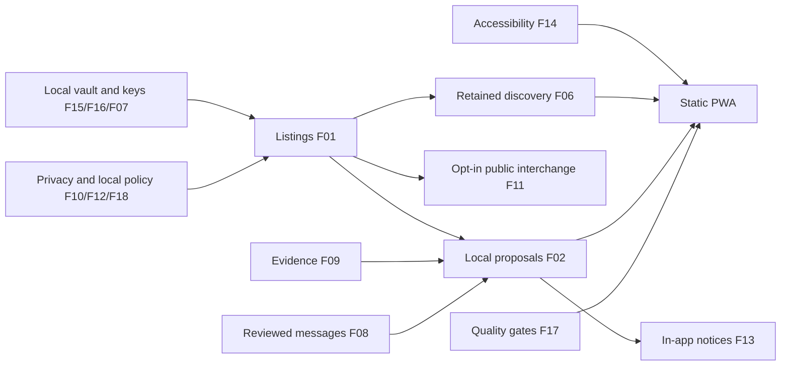

# ClassRup composition and client-owned dependencies

Status: engineering baseline pending independent review. [Architecture](CLIENT_SIDE_ARCHITECTURE.md) overrides conflicting historical proposals. [INDEX.md](../INDEX.md) owns the hierarchy; [registry](SPEC_REGISTRY.csv) owns process IDs/paths. No child is approved by this document.

## INT-001 — Aggregation

Process schema/validation/state/command/permission/retry/privacy/telemetry/test/export contracts combine into one module; sibling modules combine into a subfeature facade; features combine into the PWA. Parents pass only when all required children AND composed journeys are reviewed. Functions/events here run within a client; arrows do not mean hosted services. No mandatory gateway.

## INT-002 — Record ownership

| Feature | Canonical local responsibility | External limits |
|---|---|---|
| F01 | listings, variants, offers, local inventory reservations | cannot exclude promises from another device/dishonest seller |
| F02 | bounded candidates, proposals, digest-bound consent evidence, local coordination | each party owns its commitment; no atomic multi-vault lock |
| F03 | service catalog, proposed appointments, work assertions | no guaranteed availability or delivery |
| F04 | signed bid proposals and locally computed close view | no trusted time, global ordering, sealed-bid fairness without agreed reviewed protocol |
| F05 | proposed rental calendar, condition/deposit evidence | no global exclusive lease or escrow |
| F06 | search of approved retained projections, coarse region | unknown market coverage/freshness; no address index |
| F07 | key principal, pseudonym, local profile, peer-key contacts | no central account/session/identity assurance |
| F08 | local drafts and reviewed encrypted thread protocol | send blocked pending key/device/encryption review; transport cannot read plaintext |
| F09 | claims, acknowledgements, selected-source observations, money/FX metadata | no custody/product webhook authority or irreversibility promise |
| F10 | local disclosure, retention, export/delete controls | remote copies and key loss cannot be undone |
| F11 | public signed interchange, chosen adapters, import quarantine, tombstones | neither trusted authority nor guaranteed delivery/erasure |
| F12 | local filters, voluntary reports, selected signed policy feeds | no global ban, Sybil resistance or compelled peer compliance |
| F13 | local in-app notices and preferences | closed-browser push/email require separately chosen external dependency |
| F14 | accessible local presentation, localization and formatting | canonical monetary value never changed for display |
| F15 | PWA, vault transactions, adapters, cache, local diagnostics/config/backup | legacy 02_backend folder is historical naming; no product backend allowed |
| F16 | local permissions/key lifecycle, signature/crypto policy | unknown/revoked keys fail closed; device compromise remains risk |
| F17 | spec/test/build/acceptance evidence | no feature inherits a passing gate from text or sibling |
| F18 | locally selected content/jurisdiction policies and voluntary governance | no invented legal approval or global platform authority |

## INT-003 — Dependency-ready order

Local contract/storage/key/permission/disclosure rules F15/F16/F07/F10 and policy/accessibility F12/F18/F14 precede F01 local drafts and F06 local discovery. F09 evidence and F08 reviewed messaging precede F02 integrated exchanges; F13 consumes local validated events. F03/F04/F05/F11 remain tracked and require their own contracts. F17 checks every wave. Local draft editing/search/matching must remain usable when every optional transport is absent.

## INT-004 — Local event consumers and disclosure

- `listing.created`: F01 local edit UI and local diagnostics only; private draft never to search/federation/notifications outside vault.
- `listing.published`: F06 local projection; F11 only after separate explicit public export consent; F13 generic local notice. Publication here means an approved local public projection, not remote audience reach.
- `reservation.created`: F02 local feasibility and F13 in-app status. This is local-only; peer commitments are separately verified records.
- `cycle.proposed`: F02 stores exact digest and participant commitments; F08 cannot automatically create or send a remote thread. F13 local reminder does not notify remote parties.
- `cycle.consent_recorded`: F02 recomputes known current consent; never infers global lock or delivery from it.
- `payment.claimed` / `payment.observed` / `payment.verification_revoked`: F01/F02 display evidence provenance only under exact rail policy; no automatic goods release.
- `moderation.local_hidden`: F06 removes local view; F11 may prepare user-approved tombstone, with no global takedown promise.
- `federation.record_imported`: F11 validation -> F12 local policy/quarantine -> F06 retained projection; never an authoritative local F01 listing.
- `principal.deletion_requested`: local per-store processors show export/exception consequences; off-device copies and backups separately disclosed.
- `message.sent`: only reviewed encrypted protocol produces send evidence; F13 notices contain no plaintext. No server sequence or account tenant.

Idempotency is scoped to the local vault/consumer and exact digest. At-least-once optional transport does not provide exactly-once delivery. Subscriber compatibility and store transaction boundaries must be specified by each leaf before GO.

## INT-005 — Scope and gates

All 18 features and 1,480 process contracts stay required planning scope. Dependency-first local draft/search/evidence work is an implementation order, not automatic MVP deferral. Messaging encryption, identity recovery/export, peer signature profile, trusted-time auction claims, paid audience semantics, target jurisdiction, verified payment rails, push/email and federation interop have unresolved review/owner gates. Disabled behavior must have exact errors and no network/secret side effects. Approval of an explicit deferral requires its own requirement IDs, rationale, owner and fail-closed acceptance; none is manufactured here.
